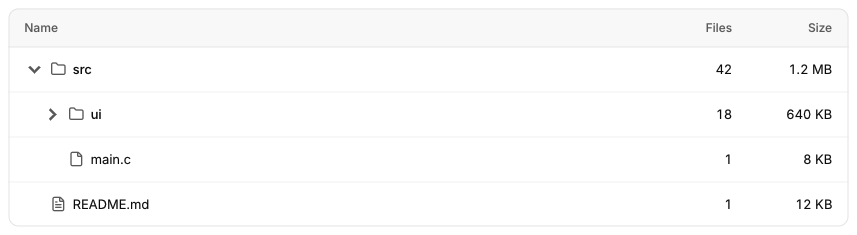

# Tree cell

The gallery uses tree cells in the Name column of its ordinary source
table. The cells indent names and let the user expand folders.
Available in **GUI**.



## Example

```pascal
unit Docs.Ui.DataGrid.TreeCell;

uses Fpas.Ui.Elements as E;
uses Fpas.Ui.Widgets.Collections.Tables as T;
uses Fpas.Ui.Widgets.Collections.TreeTables as W;

// Displays a source folder inside an ordinary table.
// ## Parameters
// - `Open`: Whether the folder's child should be visible.
// ## Returns
// An expandable table with the proposed expansion as its message.
public function View(Open: bool): E.Element of bool;
begin
  const Folder: T.Row of bool := new T.Row of bool('src', [
    (T.Cell of bool).Content([W.TreeCell of bool('src-name', 'src', 0, Open,
      function(Expanded: bool): bool => Expanded)]),
    (T.Cell of bool).Text('8 KB')
  ]);
  const Source: T.Row of bool := new T.Row of bool('main', [
    (T.Cell of bool).Content([W.TreeCell of bool('main-name', 'main.c', 1)]),
    (T.Cell of bool).Text('8 KB')
  ]);
  const Rows: array of T.Row of bool := if Open then [Folder, Source] else [Folder] end if;
  return T.Table of bool('source-files', [new T.Column('Name'), new T.Column('Size')], Rows);
end function;

end unit;
```

## Options and defaults

| Option | Default or requirement |
| --- | --- |
| `Id / Label / Depth` | Stable cell ID, literal name and nonnegative indentation level. |
| `Open / OnChange` | null / null. Pass a Boolean and a mapper for an expandable branch. |
| `Icon` | Empty. Pass a native glyph to show an icon beside the name. |

## Interaction

Place the tree cell inside `Tables.Cell.Content`. Use the branch's message
to set its expansion in the model. Build the visible rows from that model
so collapsing a branch removes its descendant rows.

Set `Depth` to zero for a root. Increase `Depth` for each level below the
root. The cell adds the indentation inside the assigned column width.

## See also

- [CUI widget inventory](../../../cui-widget-inventory.md#cui_tree_table_begin)
- [Widget API and types](../../../../src/Fpas.Ui/Widgets/Collections/TreeTables.fpas)
- [Gallery example](../../../../examples/ui/gui/gallery/Pages/DataGrid/View.fpas)
- [Table](../data-display/table.md)
- [Tree table](tree-table.md)
- [Data grid](README.md)
