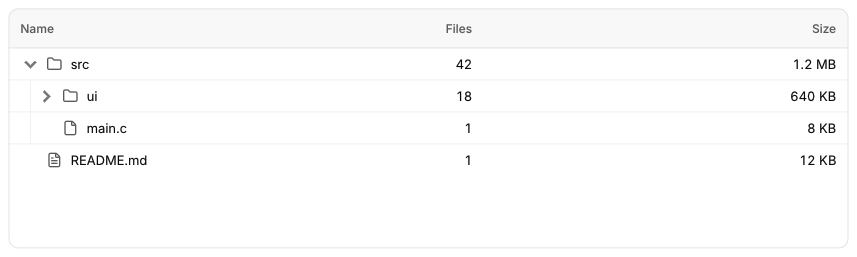

# Tree table

Use a tree table when nested rows need columns for values such as file count
and size. The gallery shows a virtual tree table and an ordinary table using
indented tree cells. Available in **GUI**.



## Example

```pascal
unit Docs.Ui.DataGrid.TreeTable;

uses Fpas.Ui.Elements as E, Fpas.Ui.Layout as L,
  Fpas.Ui.Widgets.Collections.TreeTables as W,
  Fpas.Ui.Widgets.Collections.DataGrids as D, Fpas.Ui.Widgets.Collections.Tables as T;

// Builds the file summary tree.
// ## Parameters
// - `Nodes`: Nodes in sibling order, with parents before their children.
// - `Cursor`: Current node index or minus one.
// ## Returns
// The tree with each proposed change as an application message.
public function View(Nodes: array of W.Node; Cursor: int): E.Element<W.Change>;
begin
  return W.TreeTable<W.Change>('project-tree',
    [new D.Column('Name', 320.0F), new D.Column('Size', 100.0F, T.Alignment.Right)],
    Nodes, Cursor, null, function(Change: W.Change): W.Change => Change,
    new W.Options(Height := L.Extent.Fixed(L.Measure.Logical(240)), Guides := true));
end function;

end unit;
```

## Options and defaults

| Option | Default or requirement |
| --- | --- |
| `Columns / Node.Cells` | Put Name first. Each node supplies one text value for every remaining column. |
| `Node.Parent` | Minus one for a root. For a child, use the index of a preceding parent. |
| `Node.HasChildren / Open / Selected / Loading` | All false. A branch can advertise children before they are loaded. |
| `Cursor / Order` | Use minus one for no cursor and null to disable sorting. |
| `Height / RowHeight / Guides` | Fill / 32 logical points / false. |

## Interaction

Arrow keys navigate and expand or collapse branches. Enter activates the
current node. Store the proposed nodes and cursor. For each index in
`Change.Load`, supply the children and clear the parent's loading flag after
the load finishes.

Use a [tree cell](tree-cell.md) inside an ordinary table when the
application builds the visible rows itself.

## See also

- [Widget API and types](../../../../src/Fpas.Ui/Widgets/Collections/TreeTables.fpas)
- [Gallery example](../../../../examples/ui/gui/gallery/Pages/DataGrid/View.fpas)
- [Gallery update function](../../../../examples/ui/gui/gallery/Pages/DataGrid/Update.fpas)
- [Data grid](README.md)

## Source files

- `src/Fpas.Ui.Gui/Internal/Widgets/Collections/`
  - [TreeTable.fpas](../../../../src/Fpas.Ui.Gui/Internal/Widgets/Collections/TreeTable.fpas)
- `src/Fpas.Ui.Gui.Cui/Interop/Collections/`
  - [NativeMethods.TreeTable.cs](../../../../src/Fpas.Ui.Gui.Cui/Interop/Collections/NativeMethods.TreeTable.cs)
- `src/Fpas.Ui.Gui.Cui/Widgets/Collections/`
  - [CuiWindow.TreeTable.Types.cs](../../../../src/Fpas.Ui.Gui.Cui/Widgets/Collections/CuiWindow.TreeTable.Types.cs)
  - [CuiWindow.TreeTable.cs](../../../../src/Fpas.Ui.Gui.Cui/Widgets/Collections/CuiWindow.TreeTable.cs)
- `src/Fpas.Ui.Gui.Cui/native/widgets/collections/`
  - [tree_table.c](../../../../src/Fpas.Ui.Gui.Cui/native/widgets/collections/tree_table.c)
  - [tree_table.h](../../../../src/Fpas.Ui.Gui.Cui/native/widgets/collections/tree_table.h)
