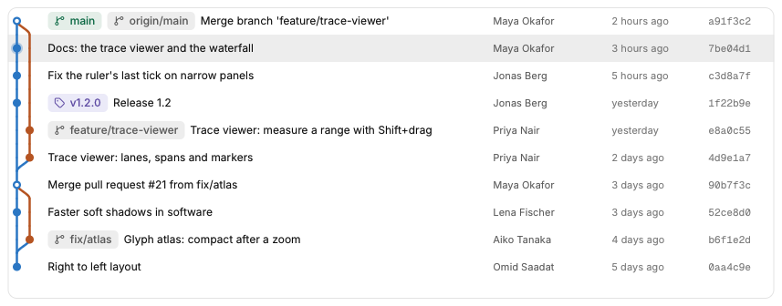

# Commit graph

Use a commit graph for history with lanes for branches and merges.
The gallery supplies sample commits with messages and refs.
Available in **GUI**.



## Example

```pascal
unit Docs.Ui.DeveloperTools.CommitGraph;

uses Fpas.Ui.Elements as E;
uses Fpas.Ui.Widgets.Developer.CommitGraphs as W;

// Displays a repository history already loaded by the application.
// ## Parameters
// - `Commits`: Commits newest first, with parents later in the array.
// - `Selected`: Selected commit index, or minus one.
// ## Returns
// The graph with row selection and activation proposals.
public function View(Commits: array of W.Commit; Selected: int): E.Element of W.Event;
begin
  return W.CommitGraph of W.Event('history', Commits, Selected,
    function(Change: W.Event): W.Event => Change, new W.Options(Height := 320.0F));
end function;

end unit;
```

## Options and defaults

| Option | Default or requirement |
| --- | --- |
| `Parent / MergeParent` | Pass the index of each parent later in the array. Use minus one when absent. |
| `Hash / Message` | Pass the full hash and message. CUI shows the short hash and the first message line. |
| `Author / Date / Refs` | Pass nullable author, formatted date and comma-separated references. Prefix a tag with `tag: `. |
| `Width / Height / Enabled` | Fill / 0 / true. Height zero uses 320 logical units. Minus one fills the available space. |
| `Selection` | Pass the selected row, minus one for none, or null to let CUI retain the selection. |
| `Hovered` | null. Set minus one to start tracking hover. Store the last `Event.Hovered` value to receive changes only. |

Below 560 logical units, CUI hides the author and date columns. Only the
selected row shows references at that width.

## Interaction

CUI builds visible rows as the history scrolls. Click a row or use Up and Down
to select a commit. Home and End select the first and last rows. Enter or
double-click activates a row. Use the zero-based index to resolve the commit.
Request focus with the graph's stable ID.

## See also

- [CUI widget inventory](../../../cui-widget-inventory.md#cui_commit_graph)
- [Widget API and types](../../../../src/Fpas.Ui/Widgets/Developer/CommitGraphs.fpas)
- [Gallery example](../../../../examples/ui/gui/gallery/Pages/Developer/View.fpas)
- [Blame](../more-developer-tools/blame.md)
- [Developer tools](README.md)

## Source files

- `src/Fpas.Ui.Gui/Internal/Widgets/Developer/`
  - [CommitGraph.fpas](../../../../src/Fpas.Ui.Gui/Internal/Widgets/Developer/CommitGraph.fpas)
- `src/Fpas.Ui.Gui.Cui/Interop/Developer/`
  - [NativeMethods.CommitGraph.cs](../../../../src/Fpas.Ui.Gui.Cui/Interop/Developer/NativeMethods.CommitGraph.cs)
- `src/Fpas.Ui.Gui.Cui/Widgets/Developer/`
  - [CuiWindow.CommitGraph.cs](../../../../src/Fpas.Ui.Gui.Cui/Widgets/Developer/CuiWindow.CommitGraph.cs)
- `src/Fpas.Ui.Gui.Cui/native/widgets/developer/`
  - [commit_graph.c](../../../../src/Fpas.Ui.Gui.Cui/native/widgets/developer/commit_graph.c)
  - [commit_graph.h](../../../../src/Fpas.Ui.Gui.Cui/native/widgets/developer/commit_graph.h)
- [Native graph tests](../../../../src/Fpas.Ui.Gui.Cui/native/tests/developer_graphs.c)
