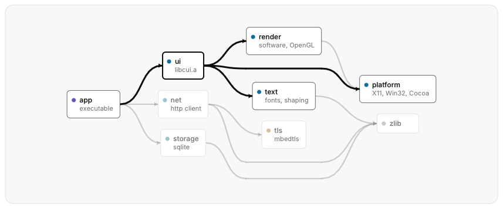

# Dependency graph

Use a dependency graph to see how components are connected. The gallery
lays out build dependencies in layers.
Available in **GUI**.



## Example

```pascal
unit Docs.Ui.DeveloperTools.DependencyGraph;

uses Fpas.Ui.Elements as E, Fpas.Ui.Widgets.Developer.DependencyGraphs as W;

// Shows a directed graph.
// ## Parameters
// - `Vertices`: Nodes in model order.
// - `Edges`: Directed edges between zero-based node indices.
// - `Selected`: Selected node index, or minus one.
// ## Returns
// The graph with selection and activation as application messages.
public function View(Vertices: array of W.Vertex; Edges: array of W.Edge; Selected: int): E.Element<W.Event>;
begin
  return W.DependencyGraph<W.Event>('dependencies', Vertices, Edges, Selected,
    function(Change: W.Event): W.Event => Change, new W.Options(Height := 340.0F));
end function;

end unit;
```

## Options and defaults

| Option | Default or requirement |
| --- | --- |
| `Vertex.Label / Detail / Tone` | Supply the node label, an optional detail and a native tone code. |
| `Edge.From / To` | Indices in the input vertex array. CUI computes a layered layout when the graph changes. |
| `TopDown / Width / Height / Enabled` | false / Fill / 0 / true. TopDown stacks the layers vertically. |

## Interaction

Hover a node to see what it depends on and what depends on it. Drag to pan,
use the wheel to zoom and press F to fit. Save `Event.Selection` and use
`Activated` to open details for the node.

## See also

- [Widget API and types](../../../../src/Fpas.Ui/Widgets/Developer/DependencyGraphs.fpas)
- [Gallery example](../../../../examples/ui/gui/gallery/Pages/Developer/View.fpas)
- [Developer tools](README.md)

## Source files

- `src/Fpas.Ui.Gui/Internal/Widgets/Developer/`
  - [DependencyGraph.fpas](../../../../src/Fpas.Ui.Gui/Internal/Widgets/Developer/DependencyGraph.fpas)
- `src/Fpas.Ui.Gui.Cui/Interop/Developer/`
  - [NativeMethods.DependencyGraph.cs](../../../../src/Fpas.Ui.Gui.Cui/Interop/Developer/NativeMethods.DependencyGraph.cs)
- `src/Fpas.Ui.Gui.Cui/Widgets/Developer/`
  - [CuiWindow.DependencyGraph.cs](../../../../src/Fpas.Ui.Gui.Cui/Widgets/Developer/CuiWindow.DependencyGraph.cs)
- `src/Fpas.Ui.Gui.Cui/native/widgets/developer/`
  - [dependency_graph.c](../../../../src/Fpas.Ui.Gui.Cui/native/widgets/developer/dependency_graph.c)
  - [dependency_graph.h](../../../../src/Fpas.Ui.Gui.Cui/native/widgets/developer/dependency_graph.h)
