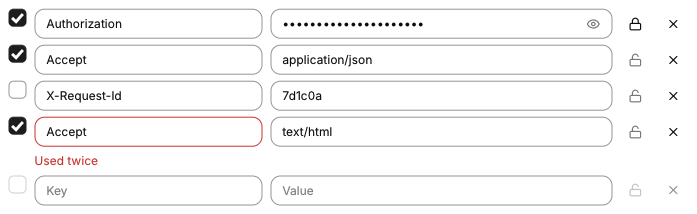
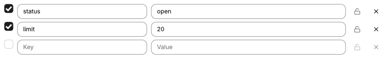

# Key-value editor

Use a key-value editor for an ordered list of named values. The gallery
shows request headers and uses the same widget for query parameters.
Available in **GUI**.



## Example

```pascal
unit Docs.Ui.DeveloperTools.KeyValueEditor;

uses Fpas.Ui.Elements as E;
uses Fpas.Ui.Widgets.Developer.KeyValueEditors as W;

// Edits the headers for a request draft.
// ## Parameters
// - `Pairs`: Header names, values and flags from the current draft.
// ## Returns
// The editor with proposed pairs as application messages.
public function View(Pairs: array of W.Pair): E.Element of W.Event;
begin
  return W.KeyValueEditor of W.Event('headers', Pairs,
    function(Change: W.Event): W.Event => Change, new W.Options(Capacity := 12));
end function;

end unit;
```

## Options and defaults

| Option | Default or requirement |
| --- | --- |
| `Pair.Enabled / Secret` | Enabled controls whether the pair is active. Secret masks its value in the editor. |
| `Pair.Key / Value` | Up to 63 / 255 UTF-8 bytes. |
| `Capacity / KeyPlaceholder / ValuePlaceholder` | 16 / empty / empty. Capacity limits the number of pairs. |
| `HideToggles / HideSecrets / ReadOnly / Enabled` | false / false / false / true. The first two hide the corresponding row controls. |

## Interaction

Type in the empty row to add a pair. Store `Event.Pairs` to accept edits
and apply active pairs in your application. Secret changes presentation.
The underlying string is still part of the model.



## See also

- [CUI widget inventory](../../../cui-widget-inventory.md#cui_kv_editor)
- [Widget API and types](../../../../src/Fpas.Ui/Widgets/Developer/KeyValueEditors.fpas)
- [Gallery example](../../../../examples/ui/gui/gallery/Pages/Developer/View.fpas)
- [HTTP request bar](../more-developer-tools/http-request-bar.md)
- [Developer tools](README.md)

## Source files

- `src/Fpas.Ui.Gui/Internal/Widgets/Developer/`
  - [KeyValueEditor.fpas](../../../../src/Fpas.Ui.Gui/Internal/Widgets/Developer/KeyValueEditor.fpas)
- `src/Fpas.Ui.Gui.Cui/Interop/Developer/`
  - [NativeMethods.KeyValueEditor.cs](../../../../src/Fpas.Ui.Gui.Cui/Interop/Developer/NativeMethods.KeyValueEditor.cs)
- `src/Fpas.Ui.Gui.Cui/Widgets/Developer/`
  - [CuiWindow.KeyValueEditor.cs](../../../../src/Fpas.Ui.Gui.Cui/Widgets/Developer/CuiWindow.KeyValueEditor.cs)
- `src/Fpas.Ui.Gui.Cui/native/widgets/developer/`
  - [key_value_editor.c](../../../../src/Fpas.Ui.Gui.Cui/native/widgets/developer/key_value_editor.c)
  - [key_value_editor.h](../../../../src/Fpas.Ui.Gui.Cui/native/widgets/developer/key_value_editor.h)
