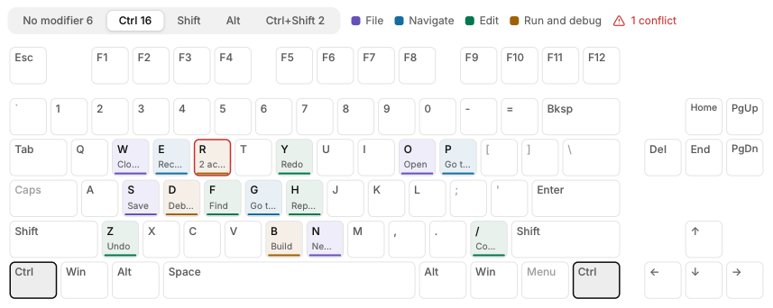

# Keymap

Use a keymap to show actions on a keyboard. The gallery highlights the
selected modifier combination and marks keys with conflicting bindings.
Available in **GUI**.



## Example

```pascal
unit Docs.Ui.DeveloperTools.Keymap;

uses Fpas.Ui.Elements as E, Fpas.Ui.Widgets.Developer.Keymaps as W;

// Shows the current keyboard bindings.
// ## Parameters
// - `Bindings`: Keys, modifiers, actions and category indices.
// - `Categories`: Legend labels in category order.
// - `Modifiers`: Modifier mask currently shown.
// ## Returns
// The keymap with modifier updates and clicked keys as messages.
public function View(Bindings: array of W.Binding; Categories: array of string; Modifiers: int): E.Element<W.Event>;
begin
  return W.Keymap<W.Event>('shortcuts', Bindings, Categories, Modifiers,
    function(Change: W.Event): W.Event => Change);
end function;

end unit;
```

## Options and defaults

| Option | Default or requirement |
| --- | --- |
| `Binding.Modifiers / Key` | Use the same modifier and key codes as the [shortcut recorder](../smart-inputs/shortcut-recorder.md). |
| `Binding.Action / Category` | Pass the action label and a zero-based category index. |
| `Width / HideFunctionRow / Enabled` | Fill / false / true. Set HideFunctionRow to omit the function keys. |

## Interaction

Change the modifier selection to browse bindings. Hover a key for all its
actions. Store `Event.Modifiers` and use `Event.Key` to open binding details.
`Conflicts` counts bindings that repeat a combination.

## See also

- [Widget API and types](../../../../src/Fpas.Ui/Widgets/Developer/Keymaps.fpas)
- [Gallery example](../../../../examples/ui/gui/gallery/Pages/Developer/View.fpas)
- [Developer tools](README.md)

## Source files

- `src/Fpas.Ui.Gui/Internal/Widgets/Developer/`
  - [Keymap.fpas](../../../../src/Fpas.Ui.Gui/Internal/Widgets/Developer/Keymap.fpas)
- `src/Fpas.Ui.Gui.Cui/Interop/Developer/`
  - [NativeMethods.Keymap.cs](../../../../src/Fpas.Ui.Gui.Cui/Interop/Developer/NativeMethods.Keymap.cs)
- `src/Fpas.Ui.Gui.Cui/Widgets/Developer/`
  - [CuiWindow.Keymap.cs](../../../../src/Fpas.Ui.Gui.Cui/Widgets/Developer/CuiWindow.Keymap.cs)
- `src/Fpas.Ui.Gui.Cui/native/widgets/developer/`
  - [keymap.c](../../../../src/Fpas.Ui.Gui.Cui/native/widgets/developer/keymap.c)
  - [keymap.h](../../../../src/Fpas.Ui.Gui.Cui/native/widgets/developer/keymap.h)
