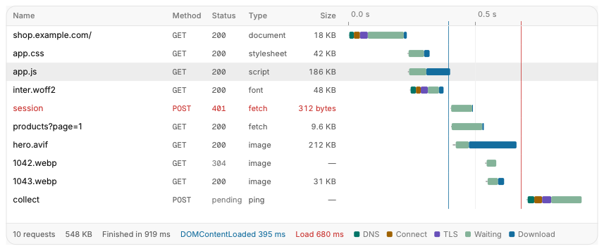

# Network waterfall

Use a network waterfall to compare HTTP request timings. The gallery
marks DOMContentLoaded and load on the shared time scale.
Available in **GUI**.



## Example

```pascal
unit Docs.Ui.DeveloperTools.NetworkWaterfall;

uses Fpas.Ui.Elements as E;
uses Fpas.Ui.Widgets.Developer.NetworkWaterfalls as W;

// Displays timing data collected by the application.
// ## Parameters
// - `Requests`: Captured requests and phase durations.
// - `Selected`: Selected request index, or minus one.
// ## Returns
// The waterfall with selected and activated requests as proposals.
public function View(Requests: array of W.Request; Selected: int): E.Element of W.Event;
begin
  return W.NetworkWaterfall of W.Event('network', Requests, Selected,
    function(Change: W.Event): W.Event => Change,
    new W.Options(Height := 340.0F, DomLoaded := 0.395, Loaded := 0.68));
end function;

end unit;
```

## Options and defaults

| Option | Default or requirement |
| --- | --- |
| `Name / Method` | Pass a path or URL. Null method displays GET. |
| `Start / Queued / Dns / Connect / Tls / Wait / Download` | Pass seconds relative to the start of the page for Start and durations in seconds for the phases. |
| `Status / Type / Size` | Use status zero when pending or failed. Type can be null. Size is the number of bytes transferred. |
| `DomLoaded / Loaded` | Both zero. A positive time in seconds draws its marker. |
| `Width / Height / Enabled` | Fill / 320 logical units / true. Zero uses the default height. A negative height fills the parent. |
| `Selection` | Pass a request index or minus one to keep selection in the application model. Pass null to let CUI keep selection. |
| `Hovered` | Null. Store the previous hover index here to receive hover-only proposals. |

## Interaction

Hover a bar for the timing breakdown. At widths below 600 logical units,
the waterfall omits the method, type and size columns.

With focus, Up and Down move selection. Home and End move to the first
and last request. Double-click or press Enter to activate. Escape clears
the selection. Map `Selection`, `Clicked`, `Activated` and `Hovered` to the
original request array. Minus one means no request.

When the application owns selection, store the proposed selection and pass
it back to the widget. When CUI owns selection, keep passing null. Both
modes report the current index with click, activation and hover proposals.

## See also

- [CUI widget inventory](../../../cui-widget-inventory.md#cui_waterfall)
- [Widget API and types](../../../../src/Fpas.Ui/Widgets/Developer/NetworkWaterfalls.fpas)
- [Gallery example](../../../../examples/ui/gui/gallery/Pages/Developer/View.fpas)
- [HTTP request bar](../more-developer-tools/http-request-bar.md)
- [Developer tools](README.md)

## Source files

- `src/Fpas.Ui.Gui/Internal/Widgets/Developer/`
  - [NetworkWaterfall.fpas](../../../../src/Fpas.Ui.Gui/Internal/Widgets/Developer/NetworkWaterfall.fpas)
- `src/Fpas.Ui.Gui.Cui/Interop/Developer/`
  - [NativeMethods.NetworkWaterfall.cs](../../../../src/Fpas.Ui.Gui.Cui/Interop/Developer/NativeMethods.NetworkWaterfall.cs)
- `src/Fpas.Ui.Gui.Cui/Widgets/Developer/`
  - [CuiWindow.NetworkWaterfall.cs](../../../../src/Fpas.Ui.Gui.Cui/Widgets/Developer/CuiWindow.NetworkWaterfall.cs)
- `src/Fpas.Ui.Gui.Cui/native/widgets/developer/`
  - [network_waterfall.c](../../../../src/Fpas.Ui.Gui.Cui/native/widgets/developer/network_waterfall.c)
  - [network_waterfall.h](../../../../src/Fpas.Ui.Gui.Cui/native/widgets/developer/network_waterfall.h)
