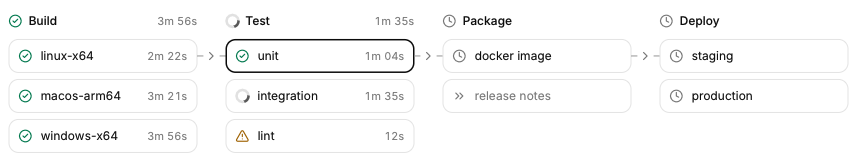

# Pipeline

Use a pipeline to show the progress of build, test or release jobs.
In the gallery, stage headers summarize the supplied job statuses.
Available in **GUI**.



## Example

```pascal
unit Docs.Ui.DeveloperTools.Pipeline;

uses Fpas.Ui.Elements as E;
uses Fpas.Ui.Widgets.Developer.Pipelines as W;

// Displays the current CI run.
// ## Parameters
// - `Stages`: Stage names in display order.
// - `Jobs`: Jobs with stage indices and current statuses.
// - `Selected`: Selected job index, or minus one.
// ## Returns
// The pipeline with selected and clicked jobs as proposals.
public function View(Stages: array of string; Jobs: array of W.Job; Selected: int): E.Element of W.Event;
begin
  return W.Pipeline of W.Event('ci', Stages, Jobs, Selected,
    function(Change: W.Event): W.Event => Change);
end function;

end unit;
```

## Options and defaults

| Option | Default or requirement |
| --- | --- |
| `Job.Stage` | Zero-based stage index. |
| `Job.Status` | 0 pending, 1 running, 2 passed, 3 failed, 4 skipped, 5 canceled. |
| `Job.Duration / AllowFailure` | Pass seconds or a negative duration if unavailable. `AllowFailure` keeps a failed job from failing its stage. |
| `Selection` | Pass a job index or -1 for no current selection. Null omits selection styling and keeps activation available. |
| `Width / Enabled` | Fill / true. Stages stack vertically below 560 logical units. |
| `Hovered` | Null. Supply the last reported hover index to receive hover changes. Start with -1. |

## Interaction

Click a job or focus it and press Enter or Space to activate it. A focus
request for the pipeline targets the selected job or the first input job.
Use `Clicked` to open job output and store `Selection` when tracking it.

Apply `Event.Hovered` to `Options.Hovered` to track pointer changes. The
index is -1 when the pointer leaves the jobs. Every proposal also includes
the current hover index. Supply updated statuses and durations as jobs progress.

## See also

- [CUI widget inventory](../../../cui-widget-inventory.md#cui_pipeline)
- [Widget API and types](../../../../src/Fpas.Ui/Widgets/Developer/Pipelines.fpas)
- [Gallery example](../../../../examples/ui/gui/gallery/Pages/Developer/View.fpas)
- [Test explorer](../more-developer-tools/test-explorer.md)
- [Developer tools](README.md)

## Source files

- `src/Fpas.Ui.Gui/Internal/Widgets/Developer/`
  - [Pipeline.fpas](../../../../src/Fpas.Ui.Gui/Internal/Widgets/Developer/Pipeline.fpas)
- `src/Fpas.Ui.Gui.Cui/Interop/Developer/`
  - [NativeMethods.Pipeline.cs](../../../../src/Fpas.Ui.Gui.Cui/Interop/Developer/NativeMethods.Pipeline.cs)
- `src/Fpas.Ui.Gui.Cui/Widgets/Developer/`
  - [CuiWindow.Pipeline.cs](../../../../src/Fpas.Ui.Gui.Cui/Widgets/Developer/CuiWindow.Pipeline.cs)
- `src/Fpas.Ui.Gui.Cui/native/widgets/developer/`
  - [pipeline.c](../../../../src/Fpas.Ui.Gui.Cui/native/widgets/developer/pipeline.c)
  - [pipeline.h](../../../../src/Fpas.Ui.Gui.Cui/native/widgets/developer/pipeline.h)
