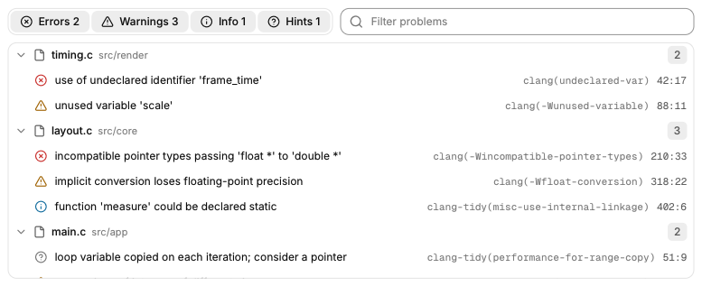

# Problems panel

Use a problems panel for compiler or lint diagnostics. The gallery
groups entries by file and lets users filter by severity or text.
Available in **GUI**.



## Example

```pascal
unit Docs.Ui.DeveloperTools.ProblemsPanel;

uses Fpas.Ui.Elements as E;
uses Fpas.Ui.Widgets.Developer.ProblemsPanels as W;

// Displays the latest diagnostics.
// ## Parameters
// - `Diagnostics`: Diagnostics in the application model.
// ## Returns
// The panel with selection and source activations as messages.
public function View(Diagnostics: array of W.Diagnostic): E.Element of W.Event;
begin
  return W.Problems of W.Event('diagnostics', Diagnostics,
    function(Change: W.Event): W.Event => Change, new W.Options(Height := 300.0F));
end function;

end unit;
```

## Options and defaults

| Option | Default or requirement |
| --- | --- |
| `Severity` | 0 error, 1 warning, 2 info, 3 hint. |
| `File / Line / Column` | Use null for an entry without a file. Lines and columns are one-based. Zero omits a location component. |
| `Width / Height / HideToolbar / Enabled` | Fill / 0 / false / true. HideToolbar hides severity filters and search. |

## Interaction

Up and Down move selection. Use Left and Right to fold or unfold groups.
Enter or double-click activates a diagnostic. Resolve `Activated` against
the supplied array and open the source location in your application.
`Shown` counts entries matching the filters.

## See also

- [Widget API and types](../../../../src/Fpas.Ui/Widgets/Developer/ProblemsPanels.fpas)
- [Gallery example](../../../../examples/ui/gui/gallery/Pages/Developer/View.fpas)
- [Developer tools](README.md)

## Source files

- `src/Fpas.Ui.Gui/Internal/Widgets/Developer/`
  - [Problems.fpas](../../../../src/Fpas.Ui.Gui/Internal/Widgets/Developer/Problems.fpas)
- `src/Fpas.Ui.Gui.Cui/Interop/Developer/`
  - [NativeMethods.Problems.cs](../../../../src/Fpas.Ui.Gui.Cui/Interop/Developer/NativeMethods.Problems.cs)
- `src/Fpas.Ui.Gui.Cui/Widgets/Developer/`
  - [CuiWindow.Problems.cs](../../../../src/Fpas.Ui.Gui.Cui/Widgets/Developer/CuiWindow.Problems.cs)
- `src/Fpas.Ui.Gui.Cui/native/widgets/developer/`
  - [problems.c](../../../../src/Fpas.Ui.Gui.Cui/native/widgets/developer/problems.c)
  - [problems.h](../../../../src/Fpas.Ui.Gui.Cui/native/widgets/developer/problems.h)
