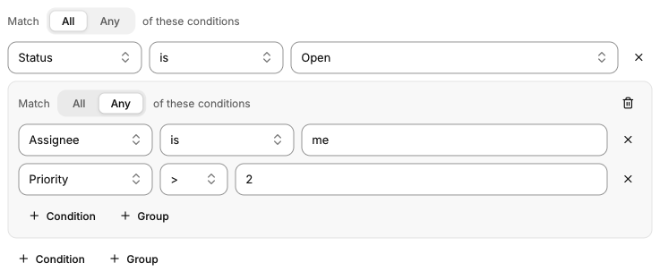

# Query builder

Use a query builder for filters with nested all and any groups. The
gallery edits an issue filter.
Available in **GUI**.



## Example

```pascal
unit Docs.Ui.DeveloperTools.QueryBuilder;

uses Fpas.Ui.Elements as E, Fpas.Ui.Widgets.Developer.QueryBuilders as W;

// Edits a filter over the available fields.
// ## Parameters
// - `Fields`: Fields that can take part in the filter.
// - `Rules`: Filter nodes in tree order, with the outer group first.
// ## Returns
// The query builder with proposed rules as messages.
public function View(Fields: array of W.Field; Rules: array of W.Rule): E.Element<W.Event>;
begin
  return W.QueryBuilder<W.Event>('filter', Fields, Rules,
    function(Change: W.Event): W.Event => Change, new W.Options(Capacity := 16));
end function;

end unit;
```

## Options and defaults

| Option | Default or requirement |
| --- | --- |
| `Field.Kind / Choices` | 0 text, 1 number, 2 choice, 3 boolean. Choices supplies labels for choice fields. |
| `Rule.Depth / Group / Any` | Depth starts at zero. Groups combine their children with all, or any when Any is true. |
| `Rule.Field / Operator / Value` | A condition takes a field index, an operator index for that field type and a comparison value as text. |
| `Capacity / MaxDepth / ReadOnly / Enabled` | 32 / 0 / false / true. Zero uses the native depth limit. |

## Interaction

CUI offers operators based on the selected field type. Groups can hold
other groups. Save `Event.Rules` and use the resulting conditions when
filtering data in your application.

## See also

- [Widget API and types](../../../../src/Fpas.Ui/Widgets/Developer/QueryBuilders.fpas)
- [Gallery example](../../../../examples/ui/gui/gallery/Pages/Developer/View.fpas)
- [Developer tools](README.md)
