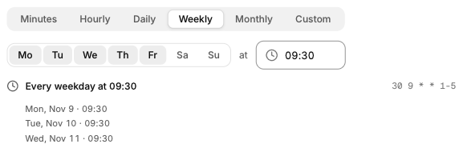

# Schedule picker

Use a schedule picker to edit a five-field cron expression. The gallery
shows a weekday backup time and its upcoming runs.
Available in **GUI**.



## Example

```pascal
unit Docs.Ui.DeveloperTools.SchedulePicker;

uses Fpas.Ui.Elements as E;
uses Fpas.Ui.Widgets.Pickers.SchedulePickers as W;

// Shows a backup schedule in UTC.
// ## Parameters
// - `Expression`: Current five-field cron expression.
// ## Returns
// The picker with cron expression changes as messages.
public function View(Expression: string): E.Element of W.Event;
begin
  return W.SchedulePicker of W.Event('backup', Expression,
    function(Change: W.Event): W.Event => Change, new W.Options(Utc := true));
end function;

end unit;
```

## Options and defaults

| Option | Default or requirement |
| --- | --- |
| `Expression` | The fields are minute, hour, day of month, month and day of week. |
| `Capacity / Width / Enabled` | 63 / Fill / true. Capacity counts UTF-8 bytes and must be at least 11. |
| `Now` | 0. Zero uses the clock. Supply Unix seconds within the CLR date range to set a reference time. |
| `Utc` | false. CUI uses the local offset at the reference time for the preview. Set true to use UTC. |
| `NextCount` | 3. Set the count from zero through ten. Zero hides the list and retains the first-run result. |

## Interaction

Edit a preset or enter a custom expression. Keep the proposed expression
as a draft. If an edit exceeds the capacity, the picker retains the current
expression. Use `Valid` before applying it and `Next` for the next run in Unix
seconds, or zero if none is available. Your application owns job execution.

## See also

- [CUI widget inventory](../../../cui-widget-inventory.md#cui_schedule_picker)
- [Widget API and types](../../../../src/Fpas.Ui/Widgets/Pickers/SchedulePickers.fpas)
- [Gallery example](../../../../examples/ui/gui/gallery/Pages/Developer/View.fpas)
- [Developer tools](README.md)

## Source files

- `src/Fpas.Ui.Gui/Internal/Widgets/Pickers/`
  - [SchedulePicker.fpas](../../../../src/Fpas.Ui.Gui/Internal/Widgets/Pickers/SchedulePicker.fpas)
- `src/Fpas.Ui.Gui.Cui/Interop/Pickers/`
  - [NativeMethods.SchedulePicker.cs](../../../../src/Fpas.Ui.Gui.Cui/Interop/Pickers/NativeMethods.SchedulePicker.cs)
- `src/Fpas.Ui.Gui.Cui/Widgets/Pickers/`
  - [CuiWindow.SchedulePicker.cs](../../../../src/Fpas.Ui.Gui.Cui/Widgets/Pickers/CuiWindow.SchedulePicker.cs)
- `src/Fpas.Ui.Gui.Cui/native/widgets/pickers/`
  - [schedule_picker.c](../../../../src/Fpas.Ui.Gui.Cui/native/widgets/pickers/schedule_picker.c)
  - [schedule_picker.h](../../../../src/Fpas.Ui.Gui.Cui/native/widgets/pickers/schedule_picker.h)
