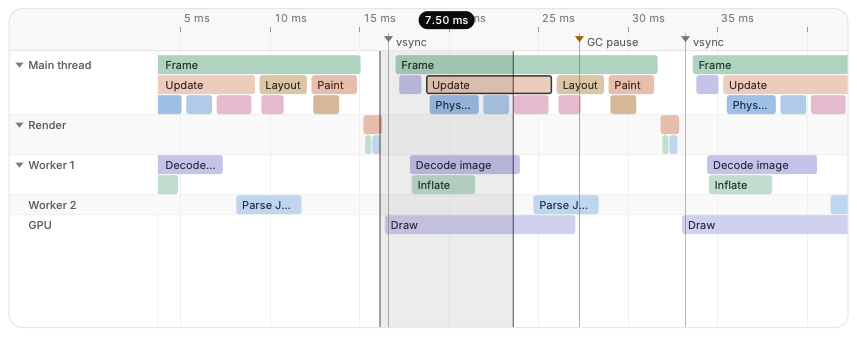

# Trace viewer

Use a trace viewer for nested time spans across threads or services.
The gallery shows several lanes and a measured interval.
Available in **GUI**.



## Example

```pascal
unit Docs.Ui.DeveloperTools.TraceViewer;

uses Fpas.Ui.Elements as E;
uses Fpas.Ui.Widgets.Developer.TraceViewers as W;

// Shows the current trace.
// ## Parameters
// - `Tracks`: Lanes and their collapsed state.
// - `Spans`: Recorded spans in track, depth and start order.
// - `Markers`: Named timestamps crossing all lanes.
// - `Viewport`: Time range, vertical offset and measurement.
// - `Selected`: Selected span index, or minus one.
// ## Returns
// The viewer with selection, lane and viewport proposals.
public function View(
  Tracks: array of W.Track;
  Spans: array of W.Span;
  Markers: array of W.Marker;
  Viewport: W.View;
  Selected: int
): E.Element of W.Event;
begin
  return W.TraceViewer of W.Event('trace', Tracks, Spans, Markers, Viewport, Selected,
    function(Change: W.Event): W.Event => Change, new W.Options(Height := 320.0F));
end function;

end unit;
```

## Options and defaults

| Option | Default or requirement |
| --- | --- |
| `Span.Start / End / Track / Depth` | Times are in seconds. Lanes and depths are zero-based. Supply nonoverlapping spans at the same depth in a lane. |
| `View.Start / End / Scroll` | Pass the visible time range in seconds and the vertical offset in points. |
| `View.MarkStart / MarkEnd` | Pass the measured interval in seconds. |
| `Width / Height / RowHeight / Enabled` | Fill / 0 / 0 / true. Zero uses native dimensions. |
| `Links / Hovered` | Empty / null. Links connect indices in the sorted span array. Supply the previous Hovered value to enable hover-only proposals. |

## Interaction

Zoom with the wheel, pan by dragging and hold Shift while dragging to
measure. Click a lane name to fold it. Save `Event.Viewport` and `Selection`.
When `TrackIndex` is nonnegative, also update the indicated lane's
`Collapsed` state.

Use `Link.From` and `To` for dependencies between spans. Each link can set a
tone, width and dashed style. `Event.Hovered` identifies the span or link
under the pointer, with minus one for neither. Store it and pass it back through
`Options.Hovered` when handling hover changes.

To position an application overlay on a span, return
`Fpas.Ui.Gui.TraceGeometry.ReadSpanRectangle` from the update. Pass the
trace control ID, the span, and a callback that wraps the resulting rectangle
in a message. The command reads logical bounds from the last presented trace
on the owner thread. An absent, folded or invisible span returns an empty
rectangle. [Native API example](../../../../examples/ui/gui/native-api/README.md)

## See also

- [CUI widget inventory](../../../cui-widget-inventory.md#cui_trace_view)
- [Widget API and types](../../../../src/Fpas.Ui/Widgets/Developer/TraceViewers.fpas)
- [Gallery example](../../../../examples/ui/gui/gallery/Pages/Developer/View.fpas)
- [Flame graph](../editing-tools/flame-graph.md)
- [Developer tools](README.md)

## Source files

- `src/Fpas.Ui.Gui/Internal/Widgets/Developer/`
  - [TraceViewer.fpas](../../../../src/Fpas.Ui.Gui/Internal/Widgets/Developer/TraceViewer.fpas)
- `src/Fpas.Ui.Gui/`
  - [TraceGeometry.fpas](../../../../src/Fpas.Ui.Gui/TraceGeometry.fpas)
- `src/Fpas.Ui.Gui.Cui/Interop/Developer/`
  - [NativeMethods.TraceViewer.cs](../../../../src/Fpas.Ui.Gui.Cui/Interop/Developer/NativeMethods.TraceViewer.cs)
  - [NativeTraceLink.cs](../../../../src/Fpas.Ui.Gui.Cui/Interop/Developer/NativeTraceLink.cs)
- `src/Fpas.Ui.Gui.Cui/Widgets/Developer/`
  - [CuiWindow.TraceViewer.Types.cs](../../../../src/Fpas.Ui.Gui.Cui/Widgets/Developer/CuiWindow.TraceViewer.Types.cs)
  - [CuiWindow.TraceViewer.cs](../../../../src/Fpas.Ui.Gui.Cui/Widgets/Developer/CuiWindow.TraceViewer.cs)
- `src/Fpas.Ui.Gui.Cui/native/widgets/developer/`
  - [trace_viewer.c](../../../../src/Fpas.Ui.Gui.Cui/native/widgets/developer/trace_viewer.c)
  - [trace_viewer.h](../../../../src/Fpas.Ui.Gui.Cui/native/widgets/developer/trace_viewer.h)
- `tests/Fpas.Ui.Gui.Cui.Tests/Display/`
  - [CuiTraceLinkTests.cs](../../../../tests/Fpas.Ui.Gui.Cui.Tests/Display/CuiTraceLinkTests.cs)
