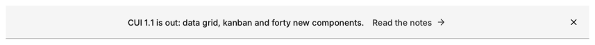

# Banner

Use a banner for an announcement that appears in the page layout. Available in **GUI**.



## Example

```pascal
unit Docs.Ui.Disclosure.Banner;

uses Fpas.Ui.Elements as E,
  Fpas.Ui.Widgets.Feedback.Banners as W;

// Builds the banner example.
// ## Parameters
// - `Open`: Current visibility from the application model.
// ## Returns
// The widget for the application view.
public function View(Open: bool): E.Element<string>;
begin
  return W.Banner<string>('release-banner', 'Version 1.1 is out.', Open,
    function(): string => 'dismiss-banner', function(): string => 'read-notes',
    new W.Options(ActionLabel := 'Read the notes'));
end function;

end unit;
```

## Options and defaults

| Option | Default or requirement |
| --- | --- |
| `Tone / Icon` | Accent / empty. Supply a CUI glyph to add an icon. |
| `ActionLabel` | Empty. Supply it together with an action message factory to show the action. |
| `OnDismiss / Enabled` | null / true. Providing a dismiss factory adds a close button. |

## Interaction

Keep visibility in the model. When the close button sends its message, set Open to false. The optional action has its own message and can keep the banner visible. Use `ActionId` and `DismissId` to identify the buttons.

## See also

- [Widget API and types](../../../../src/Fpas.Ui/Widgets/Feedback/Banners.fpas)
- [Gallery example](../../../../examples/ui/gui/gallery/Pages/Disclosure/Widgets/Banner.fpas)
- [Disclosure](README.md)
