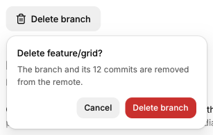

# Confirm popover

Use a confirm popover for a short question next to the action that opened it. Available in **GUI**.



## Example

```pascal
unit Docs.Ui.Disclosure.ConfirmPopover;

uses Fpas.Ui.Elements as E;
uses Fpas.Ui.Widgets.Actions.Buttons as B;
uses Fpas.Ui.Widgets.Overlays.ConfirmPopovers as W;

// Builds the confirm popover example.
// ## Parameters
// - `Open`: Current visibility from the application model.
// ## Returns
// The widget for the application view.
public function View(Open: bool): E.Element of string;
begin
  return W.ConfirmPopover of string('branch-question',
    B.Button of string('branch-trigger', 'Delete branch', 'ask-delete'), Open,
    new W.Options('Delete feature/grid?', ConfirmLabel := 'Delete branch', Danger := true),
    'delete-branch', 'cancel-delete');
end function;

end unit;
```

## Options and defaults

| Option | Default or requirement |
| --- | --- |
| `Title` | null. A question above the actions. |
| `Description` | null. More information below the question. |
| `ConfirmLabel` | Confirm. Supply a nonblank caption. |
| `CancelLabel` | Cancel. Supply a nonblank caption. |
| `Danger` | false. Use the native danger style for the confirm action. |
| `Position` | BottomStart. Set the preferred placement relative to the trigger. |

## Interaction

Set `Open` in the model when the trigger opens the question. CUI wraps the
text in a panel with a preferred width of 290 logical units. It fits the
panel to the viewport using `Position`.

The confirm action receives focus and requires a separate activation. When
focus moves outside the panel, Enter stays with the focused control. Cancel,
Escape or a press outside proposes `OnDismiss`. Close the question in
`Update` after `OnConfirm` or `OnDismiss`.

If focus is inside the panel when it closes, the trigger receives focus.
Use `ConfirmId` and `CancelId` to inspect the two buttons.

## See also

- [CUI widget inventory](../../../cui-widget-inventory.md#cui_confirm_popover)
- [Widget API and types](../../../../src/Fpas.Ui/Widgets/Overlays/ConfirmPopovers.fpas)
- [Gallery example](../../../../examples/ui/gui/gallery/Pages/Disclosure/Widgets/ConfirmPopover.fpas)
- [Popover](../overlays/popover.md)
- [Dialog](../overlays/dialog.md)
- [Disclosure](README.md)

## Source files

- `src/Fpas.Ui.Gui/Internal/Widgets/Overlays/`
  - [ConfirmPopover.fpas](../../../../src/Fpas.Ui.Gui/Internal/Widgets/Overlays/ConfirmPopover.fpas)
- `src/Fpas.Ui.Gui.Cui/Interop/Overlays/`
  - [NativeMethods.ConfirmPopover.cs](../../../../src/Fpas.Ui.Gui.Cui/Interop/Overlays/NativeMethods.ConfirmPopover.cs)
- `src/Fpas.Ui.Gui.Cui/Widgets/Overlays/`
  - [CuiWindow.ConfirmPopover.cs](../../../../src/Fpas.Ui.Gui.Cui/Widgets/Overlays/CuiWindow.ConfirmPopover.cs)
- `src/Fpas.Ui.Gui.Cui/native/widgets/overlays/`
  - [confirm_popover.c](../../../../src/Fpas.Ui.Gui.Cui/native/widgets/overlays/confirm_popover.c)
  - [confirm_popover.h](../../../../src/Fpas.Ui.Gui.Cui/native/widgets/overlays/confirm_popover.h)
- [Native disclosure tests](../../../../src/Fpas.Ui.Gui.Cui/native/tests/disclosure.c)
