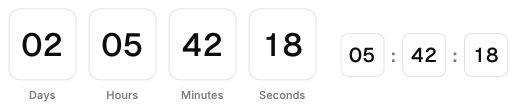

# Countdown

Use a countdown to show remaining time. The gallery displays standard tiles and a compact hours, minutes and seconds layout. Available in **GUI**.



## Example

```pascal
unit Docs.Ui.Disclosure.Countdown;

uses Fpas.Ui.Elements as E;
uses Fpas.Ui.Widgets.Feedback.Countdowns as W;

// Builds the countdown example.
// ## Parameters
// - `SecondsLeft`: Time remaining from the application clock.
// ## Returns
// The widget for the application view.
public function View(SecondsLeft: double): E.Element of string;
begin
  return W.Countdown of string('disclosure-sale', SecondsLeft, new W.Options(Compact := true, HideDays := true));
end function;

end unit;
```

## Options and defaults

| Option | Default or requirement |
| --- | --- |
| `SecondsLeft` | Finite remaining seconds up to 7,730,941,132,799. Negative values display zero. CUI discards fractions. |
| `Compact` | False. Compact tiles use colons and omit the unit names. |
| `HideDays` | False. When true, 2 days and 1 hour appear as 49 hours. |

## Interaction

Refresh the remaining time from a clock in your application. CUI rolls the
digits when a displayed unit changes. In reduced motion the digits update
without animation.

## See also

- [CUI widget inventory](../../../cui-widget-inventory.md#cui_countdown)
- [Widget API and types](../../../../src/Fpas.Ui/Widgets/Feedback/Countdowns.fpas)
- [Gallery example](../../../../examples/ui/gui/gallery/Pages/Disclosure/Widgets/Countdown.fpas)
- [Disclosure](README.md)

## Source files

- `src/Fpas.Ui.Gui/Internal/Widgets/Feedback/`
  - [Countdown.fpas](../../../../src/Fpas.Ui.Gui/Internal/Widgets/Feedback/Countdown.fpas)
- `src/Fpas.Ui.Gui.Cui/Interop/Feedback/`
  - [NativeMethods.Countdown.cs](../../../../src/Fpas.Ui.Gui.Cui/Interop/Feedback/NativeMethods.Countdown.cs)
- `src/Fpas.Ui.Gui.Cui/Widgets/Feedback/`
  - [CuiWindow.Countdown.cs](../../../../src/Fpas.Ui.Gui.Cui/Widgets/Feedback/CuiWindow.Countdown.cs)
- `src/Fpas.Ui.Gui.Cui/native/widgets/feedback/`
  - [countdown.c](../../../../src/Fpas.Ui.Gui.Cui/native/widgets/feedback/countdown.c)
  - [countdown.h](../../../../src/Fpas.Ui.Gui.Cui/native/widgets/feedback/countdown.h)
