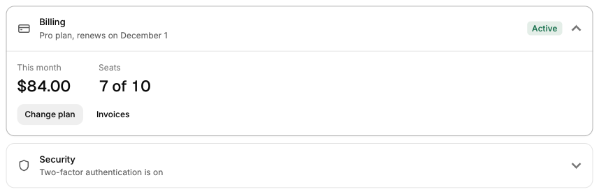

# Expandable card

Use an expandable card for a summary with details that can open beneath its header. Available in **GUI** and [TUI](../../tui/disclosure/expandable-card.md).



## Example

```pascal
unit Docs.Ui.Disclosure.ExpandableCard;

uses Fpas.Ui.Elements as E,
  Fpas.Ui.Widgets.Containers.ExpandableCards as W;

// Builds the expandable card example.
// ## Parameters
// - `Expanded`: Current expansion state.
// ## Returns
// The widget for the application view.
public function View(Expanded: bool): E.Element<bool>;
begin
  return W.ExpandableCard<bool>('billing', 'Billing', Expanded, function(Value: bool): bool => Value,
    E.Text<bool>('7 of 10 seats in use'),
    new W.Options(Description := 'Pro plan, renews on December 1', Badge := 'Active'));
end function;

end unit;
```

## Options and defaults

| Option | Default or requirement |
| --- | --- |
| `Open` | Pass the current expansion flag from the model. |
| `Description / Icon / Badge` | Empty. |
| `BadgeTone / Enabled` | Neutral / true. Disabling the card gates input to both header and body. |

## Interaction

Click the header or activate it with Enter or Space to propose the opposite expansion flag. The model decides whether to accept it. CUI draws the exit animation while the collapsing body stops accepting input.

## See also

- [Widget API and types](../../../../src/Fpas.Ui/Widgets/Containers/ExpandableCards.fpas)
- [Gallery example](../../../../examples/ui/gui/gallery/Pages/Disclosure/View.fpas)
- [Expandable text](expandable-text.md)
- [Disclosure](README.md)

## Source files

- [Shared Security example](../../../../examples/ui/gui/gallery/Shared/SecurityCard.fpas)
