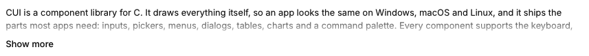
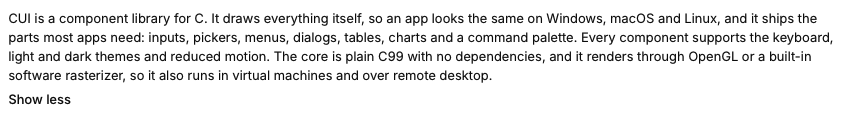

# Expandable text

Use expandable text to collapse a long passage to a few lines with a fade. Available in **GUI**.





## Example

```pascal
unit Docs.Ui.Disclosure.ExpandableText;

uses Fpas.Ui.Elements as E,
  Fpas.Ui.Widgets.Containers.ExpandableTexts as W;

// Builds the expandable text example.
// ## Parameters
// - `Text`: Current value from the application model.
// ## Returns
// The widget for the application view.
public function View(Text: string): E.Element<string>;
begin
  return W.ExpandableText<string>('about-cui', Text, new W.Options(Lines := 2));
end function;

end unit;
```

## Options and defaults

| Option | Default or requirement |
| --- | --- |
| `Lines / Size` | 3 / 0. Zero uses CUI's body text size. |
| `Color / FadeTo` | null / null. Set FadeTo if the text sits on a different surface. |
| `Enabled` | true. |
| `OnToggle` | Optional message factory called when CUI toggles the text. |

## Interaction

CUI owns expansion and shows Show more or Show less when the text exceeds the limit. Removing the widget clears its local expansion state. Use `ToggleId(Id)` to inspect or focus the link. CUI can lose focus after a toggle, so Tab or an explicit focus request can return to it.

## See also

- [Widget API and types](../../../../src/Fpas.Ui/Widgets/Containers/ExpandableTexts.fpas)
- [Gallery example](../../../../examples/ui/gui/gallery/Pages/Disclosure/View.fpas)
- [Expandable card](expandable-card.md)
- [Disclosure](README.md)

## Source files

- [ExpandableText.fpas](../../../../src/Fpas.Ui.Gui/Internal/Widgets/Containers/ExpandableText.fpas)
