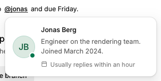

# Hover card

Use a hover card for a preview anchored to an interactive control. The gallery opens a profile preview from the @jonas link. Available in **GUI**.



## Example

```pascal
unit Docs.Ui.Disclosure.HoverCard;

uses Fpas.Ui.Elements as E;
uses Fpas.Ui.Widgets.Display.Links as L;
uses Fpas.Ui.Widgets.Overlays.HoverCards as W;

// Builds the hover card example.
// ## Parameters
// - `Content`: Current value from the application model.
// ## Returns
// The widget for the application view.
public function View(Content: E.Element of string): E.Element of string;
begin
  return W.HoverCard of string('jonas-card', L.Link of string('jonas-link', '@jonas', 'open-profile'), Content);
end function;

end unit;
```

## Options and defaults

| Option | Default or requirement |
| --- | --- |
| `Trigger` | Supply a single interactive control or a card with `Hoverable` enabled. |
| `Position` | `BottomStart`. CUI can flip the preferred side to fit the available space. |
| `Width` | 300 logical units. Zero uses the default. |
| `Delay` | 0.45 seconds. Zero uses the default. |
| `Enabled` | `true`. The trigger must also accept input. |

## Interaction

Rest the pointer on the trigger to open the card after the delay. The card
stays open while the pointer is over the trigger or the card. If the
pointer leaves both, CUI waits 0.2 seconds before closing the card.
Clicking the trigger or pressing Escape closes it. When the pointer is
still over the trigger, it must leave before the card opens again.

Disabling the card or its trigger closes the preview and resets its delay.
The trigger keeps its own activation behavior.

The preview waits while the pointer button is held. Releasing the button
over the trigger opens the preview if the delay has elapsed.
[CUI-051](../../../future/cui-upstream-bugs.md#cui-051)

Declare dialogs and sheets outside the hover card body. If the body has scroll
anchors, put them in a viewport inside that body.

## See also

- [CUI widget inventory](../../../cui-widget-inventory.md#cui_hover_card)
- [Widget API and types](../../../../src/Fpas.Ui/Widgets/Overlays/HoverCards.fpas)
- [Gallery example](../../../../examples/ui/gui/gallery/Pages/Disclosure/Widgets/HoverCard.fpas)
- [Link](link.md)
- [Avatar](avatar.md)
- [Disclosure](README.md)

## Source files

- `src/Fpas.Ui.Gui/Internal/Widgets/Overlays/`
  - [HoverCard.fpas](../../../../src/Fpas.Ui.Gui/Internal/Widgets/Overlays/HoverCard.fpas)
- `src/Fpas.Ui.Gui.Cui/Interop/Overlays/`
  - [NativeMethods.HoverCard.cs](../../../../src/Fpas.Ui.Gui.Cui/Interop/Overlays/NativeMethods.HoverCard.cs)
- `src/Fpas.Ui.Gui.Cui/Widgets/Overlays/`
  - [CuiWindow.HoverCard.cs](../../../../src/Fpas.Ui.Gui.Cui/Widgets/Overlays/CuiWindow.HoverCard.cs)
- `src/Fpas.Ui.Gui.Cui/native/widgets/overlays/`
  - [hover_card.c](../../../../src/Fpas.Ui.Gui.Cui/native/widgets/overlays/hover_card.c)
  - [hover_card.h](../../../../src/Fpas.Ui.Gui.Cui/native/widgets/overlays/hover_card.h)
