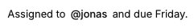

# Link

Use an inline link to send a navigation message from inside text or a row. Available in **GUI**.



## Example

```pascal
unit Docs.Ui.Disclosure.Link;

uses Fpas.Ui.Elements as E;
uses Fpas.Ui.Widgets.Display.Links as W;

// Builds the link example.
// ## Returns
// The widget for the application view.
public function View(): E.Element of string;
begin
  return W.Link of string('jonas-link', '@jonas', 'open-profile');
end function;

end unit;
```

## Options and defaults

| Option | Default or requirement |
| --- | --- |
| `Label` | Literal link text. |
| `OnActivate` | Message to send when the link is activated. |
| `Enabled` | true. |

## Interaction

Click the link or focus it and press Enter or Space. Handle the destination in your update function. In the gallery the link also anchors a hover card.

## See also

- [Widget API and types](../../../../src/Fpas.Ui/Widgets/Display/Links.fpas)
- [Gallery example](../../../../examples/ui/gui/gallery/Pages/Disclosure/Widgets/HoverCard.fpas)
- [Hover card](hover-card.md)
- [Disclosure](README.md)

## Source files

- `src/Fpas.Ui.Gui/Internal/Widgets/Display/`
  - [Link.fpas](../../../../src/Fpas.Ui.Gui/Internal/Widgets/Display/Link.fpas)
- `src/Fpas.Ui.Gui.Cui/Interop/Display/`
  - [NativeMethods.Link.cs](../../../../src/Fpas.Ui.Gui.Cui/Interop/Display/NativeMethods.Link.cs)
- `src/Fpas.Ui.Gui.Cui/Widgets/Display/`
  - [CuiWindow.Link.cs](../../../../src/Fpas.Ui.Gui.Cui/Widgets/Display/CuiWindow.Link.cs)
- `src/Fpas.Ui.Gui.Cui/native/widgets/display/`
  - [link.c](../../../../src/Fpas.Ui.Gui.Cui/native/widgets/display/link.c)
  - [link.h](../../../../src/Fpas.Ui.Gui.Cui/native/widgets/display/link.h)
