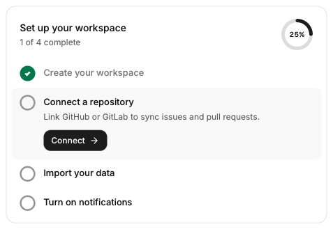

# Onboarding checklist

Use a checklist for onboarding steps with model-owned completion flags. Available in **GUI**.



## Example

```pascal
unit Docs.Ui.Disclosure.OnboardingChecklist;

uses Fpas.Ui.Elements as E;
uses Fpas.Ui.Widgets.Feedback.Checklists as W;

// Messages proposed by the completion circle and the step action.
public type Msg = variant
  // Set Done on the zero-based step Index.
  ToggleStep(Index: int; Done: bool);
  // Perform the requested action for the zero-based step Index.
  CompleteStep(Index: int);
end variant;

// Builds the onboarding checklist example.
// ## Parameters
// - `Steps`: Current steps from the model.
// ## Returns
// The widget for the application view.
public function View(Steps: array of W.Step): E.Element of Msg;
begin
  return W.Checklist of Msg('workspace-onboarding', Steps, Msg.ToggleStep, Msg.CompleteStep,
    new W.Options(Title := 'Set up your workspace'));
end function;

end unit;
```

## Options and defaults

| Option | Default or requirement |
| --- | --- |
| `Steps` | Ordered steps with a title, optional description and action label, and Done defaulting to false. |
| `Title / Description / Enabled` | Empty / empty / true. |
| `OnAction` | Optional callback receiving the index of the active step. |

## Interaction

Click or activate a completion circle with the keyboard to propose a new flag. The first incomplete step reveals its description and optional button. That button sends its step index, and the update function decides whether it is complete. Use `StepId` and `ActionId` to inspect the corresponding controls.

## See also

- [CUI widget inventory](../../../cui-widget-inventory.md#cui_checklist)
- [Widget API and types](../../../../src/Fpas.Ui/Widgets/Feedback/Checklists.fpas)
- [Gallery example](../../../../examples/ui/gui/gallery/Pages/Disclosure/Widgets/Checklist.fpas)
- [Disclosure](README.md)

## Source files

- `src/Fpas.Ui.Gui/Internal/Widgets/Feedback/`
  - [Checklist.fpas](../../../../src/Fpas.Ui.Gui/Internal/Widgets/Feedback/Checklist.fpas)
- `src/Fpas.Ui.Gui.Cui/Interop/Feedback/`
  - [NativeMethods.Checklist.cs](../../../../src/Fpas.Ui.Gui.Cui/Interop/Feedback/NativeMethods.Checklist.cs)
- `src/Fpas.Ui.Gui.Cui/Widgets/Feedback/`
  - [CuiWindow.Checklist.Types.cs](../../../../src/Fpas.Ui.Gui.Cui/Widgets/Feedback/CuiWindow.Checklist.Types.cs)
  - [CuiWindow.Checklist.cs](../../../../src/Fpas.Ui.Gui.Cui/Widgets/Feedback/CuiWindow.Checklist.cs)
- `src/Fpas.Ui.Gui.Cui/native/widgets/feedback/`
  - [checklist.c](../../../../src/Fpas.Ui.Gui.Cui/native/widgets/feedback/checklist.c)
  - [checklist.h](../../../../src/Fpas.Ui.Gui.Cui/native/widgets/feedback/checklist.h)
