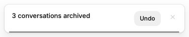

# Undo toast

Offer a short period to reverse an operation by returning a toast with an action from your update. Available in **GUI**.



## Example

```pascal
unit Docs.Ui.Disclosure.UndoToast;

uses Fpas.Ui.Gui.Toasts as W;
uses Fpas.Ui.Mvu.Application as Mvu;

// Builds the command for the update function.
// ## Returns
// A command that queues one toast in the GUI host.
public function Notify(): Mvu.Command of string;
begin
  return W.Show of string('3 conversations archived',
    new W.Options(ActionLabel := 'Undo', ShowTimer := true),
    function(): string => 'restore-conversations');
end function;

end unit;
```

## Options and defaults

| Option | Default or requirement |
| --- | --- |
| `ActionLabel / OnAction` | Supply both. The caption limit is 47 UTF-8 bytes and the reserved delimiter is ##. |
| `ShowTimer` | false. Set true for the draining line. |
| `Duration` | 0 uses CUI's six-second default with the timer. Set a positive value for another lifetime. |

## Interaction

Hover pauses the timer. Click Undo or reach it with Tab and activate it with Enter or Space. The host calls the factory once, then the application handles restoration in its update. Keep the data needed to undo the operation in the application model.

## See also

- [Widget API and types](../../../../src/Fpas.Ui.Gui/Toasts.fpas)
- [Gallery example](../../../../examples/ui/gui/gallery/Pages/Disclosure/Update.fpas)
- [Toast](../overlays/toast.md)
- [Disclosure](README.md)

## Source files

- [UndoToast.fpas](../../../../examples/ui/gui/gallery/Pages/Disclosure/Widgets/UndoToast.fpas)
