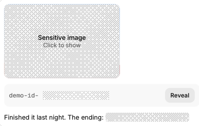
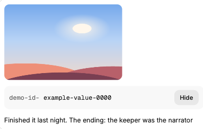

# Veil

Use a veil to visually cover a picture or spoiler until the user reveals it. Available in **GUI**.





## Example

```pascal
unit Docs.Ui.Disclosure.Veil;

uses Fpas.Ui.Elements as E;
uses Fpas.Ui.Widgets.Overlays.Veils as W;

// Builds the veil example.
// ## Parameters
// - `Shown`: Current reveal state.
// ## Returns
// The widget for the application view.
public function View(Shown: bool): E.Element of bool;
begin
  return W.Veil of bool('spoiler', Shown, function(Value: bool): bool => Value,
    E.Text of bool('The keeper was the narrator.'),
    new W.Options(Label := 'Spoiler', Hint := 'Click to show', Toggle := true, Radius := 4.0F));
end function;

end unit;
```

## Options and defaults

| Option | Default or requirement |
| --- | --- |
| `Revealed` | Pass the current visibility flag from the model. |
| `Label`, `Hint` | null. Add text and a smaller instruction to the cover. |
| `Toggle` | false. Set it to true to cover revealed content with a click. |
| `Radius` | 0 logical units. |
| `Color` | `Charts.Color.Automatic` uses the muted surface. `Charts.Color.Theme(Token)` selects an active theme color and `Charts.Color.Rgba(Value)` sets an explicit color. RGBA with zero alpha uses the muted surface. |
| `Width` | `Content` uses the child's width. |
| `Enabled` | true. Set it to false to disable input on the veil and its child. |

## Interaction

Click the covered area to propose a reveal. Enter or Space on the focused
veil toggles either state. Accept the proposal in the model. A covered veil
disables input to its child. The cover is a visual effect. Keep sensitive
data out of the view when the user lacks access.

## See also

- [CUI widget inventory](../../../cui-widget-inventory.md#cui_veil)
- [Widget API and types](../../../../src/Fpas.Ui/Widgets/Overlays/Veils.fpas)
- [Gallery example](../../../../examples/ui/gui/gallery/Pages/Disclosure/Widgets/Veil.fpas)
- [Disclosure](README.md)

## Source files

- `src/Fpas.Ui.Gui/Internal/Widgets/Overlays/`
  - [Veil.fpas](../../../../src/Fpas.Ui.Gui/Internal/Widgets/Overlays/Veil.fpas)
- `src/Fpas.Ui.Gui.Cui/Interop/Overlays/`
  - [NativeMethods.Veil.cs](../../../../src/Fpas.Ui.Gui.Cui/Interop/Overlays/NativeMethods.Veil.cs)
- `src/Fpas.Ui.Gui.Cui/Widgets/Overlays/`
  - [CuiWindow.Veil.cs](../../../../src/Fpas.Ui.Gui.Cui/Widgets/Overlays/CuiWindow.Veil.cs)
- `src/Fpas.Ui.Gui.Cui/native/widgets/overlays/`
  - [veil.c](../../../../src/Fpas.Ui.Gui.Cui/native/widgets/overlays/veil.c)
  - [veil.h](../../../../src/Fpas.Ui.Gui.Cui/native/widgets/overlays/veil.h)
- `tests/Fpas.Ui.Gui.Cui.Tests/Overlays/`
  - [CuiVeilScopeTests.cs](../../../../tests/Fpas.Ui.Gui.Cui.Tests/Overlays/CuiVeilScopeTests.cs)
- [Native color parity test](../../../../src/Fpas.Ui.Gui.Cui/native/tests/display.c)
