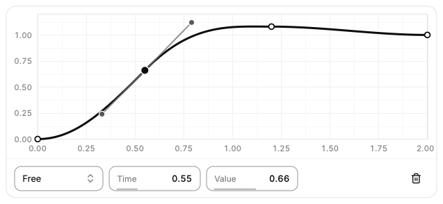

# Curve editor

Use a curve editor for values over time, such as animation easing. The
gallery shows time and value axes, selected keys and Bézier handles.
Available in **GUI**.



## Example

```pascal
unit Docs.Ui.EditingTools.CurveEditor;

uses Fpas.Ui.Elements as E;
uses Fpas.Ui.Widgets.Editors.CurveEditors as W;

// Edits an easing curve over two seconds.
// ## Parameters
// - `Keys`: Model-owned keys sorted by X.
// - `Selected`: Selected key index, or minus one.
// ## Returns
// The editor with key and selection proposals.
public function View(Keys: array of W.Key; Selected: int): E.Element of W.Event;
begin
  return W.CurveEditor of W.Event('easing', Keys, Selected,
    function(Change: W.Event): W.Event => Change,
    new W.Options(Capacity := 16, XMaximum := 2.0F, YMaximum := 1.2F,
      XLabel := 'Time', YLabel := 'Value'));
end function;

end unit;
```

## Options and defaults

| Option | Default or requirement |
| --- | --- |
| `Key.Interpolation` | Smooth. Free uses explicit handles, Linear uses a straight segment and Step holds the value. |
| `Key.InX / InY / OutX / OutY` | All zero. Handles use offsets from the key. |
| `XMinimum / XMaximum / YMinimum / YMaximum` | 0 / 1 / 0 / 1. |
| `XLabel / YLabel / Playhead` | Empty / empty / null. |
| `XFormat / YFormat` | Null uses the grid spacing to format axis labels and readouts. |
| `Width / Height / Capacity / Snap` | Fill / 0 / 32 / false. Zero height uses the native height. Enable Snap to drag on the grid. |

## Interaction

Drag keys and handles or nudge a focused key with the arrows. Double-click
the plot to add a key within Capacity. Delete removes a focused key.
Accept a change by storing the sorted keys and selected index. `Added`
indexes the new curve, and `Removed` indexes the previous curve.
`Changed` identifies a key edit. When `Hovered` is true, `HoverX` gives
the pointer's horizontal coordinate and `HoverY` gives the curve value there.

## Sample a curve

Use `Fpas.Ui.Gui.Curves.Evaluate(Keys, X)` to read the value shown by the
editor. Pass finite keys ordered by X. Smooth, Free, Linear and Step use
the same interpolation as the editor.
Positions outside the curve use the nearest end value. An empty curve
returns zero, and NaN uses the first key. The call works without a window.

## See also

- [CUI widget inventory](../../../cui-widget-inventory.md#cui_curve_editor)
- [Widget API and types](../../../../src/Fpas.Ui/Widgets/Editors/CurveEditors.fpas)
- [Gallery example](../../../../examples/ui/gui/gallery/Pages/EditingTools/View.fpas)
- [Timeline editor](timeline-editor.md)
- [Editing tools](README.md)

## Source files

- [FPAS curve sampling](../../../../src/Fpas.Ui.Gui/Curves.fpas)
- [Managed curve sampling](../../../../src/Fpas.Ui.Gui.Cui/Widgets/Editors/CuiCurve.cs)

- `src/Fpas.Ui.Gui/Internal/Widgets/Editors/`
  - [CurveEditor.fpas](../../../../src/Fpas.Ui.Gui/Internal/Widgets/Editors/CurveEditor.fpas)
- `src/Fpas.Ui.Gui.Cui/Interop/Editors/`
  - [NativeMethods.CurveEditor.cs](../../../../src/Fpas.Ui.Gui.Cui/Interop/Editors/NativeMethods.CurveEditor.cs)
- `src/Fpas.Ui.Gui.Cui/Widgets/Editors/`
  - [CuiWindow.CurveEditor.Types.cs](../../../../src/Fpas.Ui.Gui.Cui/Widgets/Editors/CuiWindow.CurveEditor.Types.cs)
  - [CuiWindow.CurveEditor.cs](../../../../src/Fpas.Ui.Gui.Cui/Widgets/Editors/CuiWindow.CurveEditor.cs)
- `src/Fpas.Ui.Gui.Cui/native/widgets/editors/`
  - [curve_editor.c](../../../../src/Fpas.Ui.Gui.Cui/native/widgets/editors/curve_editor.c)
  - [curve_editor.h](../../../../src/Fpas.Ui.Gui.Cui/native/widgets/editors/curve_editor.h)
