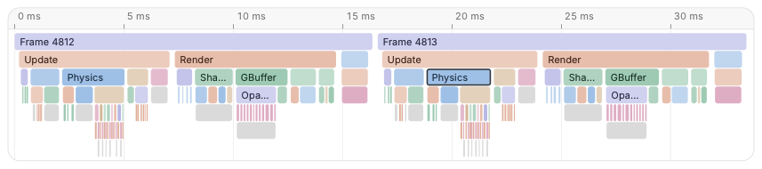

# Flame graph

Use a flame graph to inspect when calls ran and how they nested. The
gallery shows two frames of a simulated runtime capture.
Available in **GUI**.



## Example

```pascal
unit Docs.Ui.EditingTools.FlameGraph;

uses Fpas.Ui.Elements as E;
uses Fpas.Ui.Widgets.Editors.FlameGraphs as W;

// Displays frame timings.
// ## Parameters
// - `Spans`: Spans in depth order, then time order.
// - `Current`: Visible range, vertical offset and selection.
// ## Returns
// The graph with native view proposals as messages.
public function View(Spans: array of W.Span; Current: W.View): E.Element of W.Event;
begin
  return W.FlameGraph of W.Event('profile', Spans, Current,
    function(Change: W.Event): W.Event => Change);
end function;

end unit;
```

## Options and defaults

| Option | Default or requirement |
| --- | --- |
| `Span.Start / Finish / Depth` | Times are in seconds. Sort by depth, then by start, placing longer spans first on ties. |
| `Span.ColorKey` | 0. Zero hashes the name to choose a color. |
| `View.Start / Finish / Scroll / Selected` | 0 / 0 / 0 / minus one. A nonpositive visible range fits all spans. |
| `Width / Height / RowHeight` | Fill / 0 / 0. Zero uses the natural graph height or native row height. |
| `MinimumRange` | 0. Use a positive time in seconds to set the smallest zoomed range. |

## Interaction

Click a span to select it. The wheel changes the zoom and activating
a span can zoom to its duration. Store `Event.Current` to keep the
visible range and selection. `Zoomed` identifies a span zoomed to by
activation or returns minus one. `Hovered` identifies the span under the
pointer or returns minus one. `ViewChanged` and `SelectionChanged` identify
the parts of the proposal that changed.

## Inspect span bounds

Return `Fpas.Ui.Gui.FlameGeometry.ReadSpanRectangle of TMsg(Id, Span, OnRead)`
from `Update` after the first presentation. Pass a span from the presented
graph. The callback receives its rectangle in window logical units at the
last presented zoom and scroll position. An absent graph or a span outside
the plot returns an empty rectangle. The rectangle can extend past the plot
when part of a span is visible.

When drawing directly with CUI, call `CuiWindow.FlameSpanRectangle(Id, Span)`
between frames.

## See also

- [CUI widget inventory](../../../cui-widget-inventory.md#cui_flame_graph)
- [Widget API and types](../../../../src/Fpas.Ui/Widgets/Editors/FlameGraphs.fpas)
- [Gallery example](../../../../examples/ui/gui/gallery/Pages/EditingTools/View.fpas)
- [Gallery sample spans](../../../../examples/ui/gui/gallery/Pages/EditingTools/Capture.fpas)
- [Editing tools](README.md)

## Source files

- [FPAS span geometry](../../../../src/Fpas.Ui.Gui/FlameGeometry.fpas)

- `src/Fpas.Ui.Gui/Internal/Widgets/Editors/`
  - [FlameGraph.fpas](../../../../src/Fpas.Ui.Gui/Internal/Widgets/Editors/FlameGraph.fpas)
- `src/Fpas.Ui.Gui.Cui/Interop/Editors/`
  - [NativeMethods.FlameGraph.cs](../../../../src/Fpas.Ui.Gui.Cui/Interop/Editors/NativeMethods.FlameGraph.cs)
- `src/Fpas.Ui.Gui.Cui/Widgets/Editors/`
  - [CuiWindow.FlameGraph.Types.cs](../../../../src/Fpas.Ui.Gui.Cui/Widgets/Editors/CuiWindow.FlameGraph.Types.cs)
  - [CuiWindow.FlameGraph.cs](../../../../src/Fpas.Ui.Gui.Cui/Widgets/Editors/CuiWindow.FlameGraph.cs)
- `src/Fpas.Ui.Gui.Cui/native/widgets/editors/`
  - [flame_graph.c](../../../../src/Fpas.Ui.Gui.Cui/native/widgets/editors/flame_graph.c)
  - [flame_graph.h](../../../../src/Fpas.Ui.Gui.Cui/native/widgets/editors/flame_graph.h)
