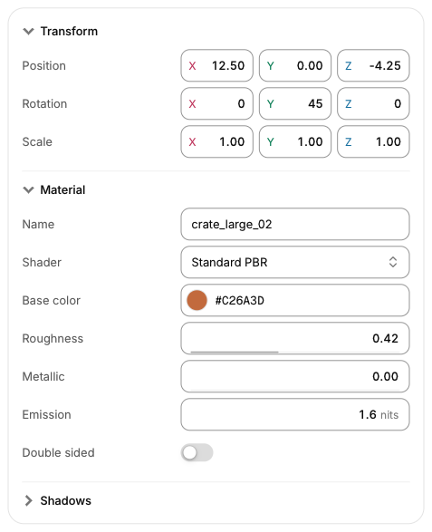

# Property inspector

Use a property inspector to edit typed values in groups. The gallery shows
a crate's transform, material and shadows. Available in **GUI**.



## Example

```pascal
unit Docs.Ui.EditingTools.PropertyInspector;

uses Fpas.Ui.Elements as E;
uses Fpas.Ui.Widgets.Editors.PropertyInspectors as W;

// Builds the inspector for the selected object.
// ## Parameters
// - `Groups`: The object's properties and expansion state.
// ## Returns
// The inspector with edits and expansion changes as messages.
public function View(Groups: array of W.Group): E.Element of W.Event;
begin
  return W.PropertyInspector of W.Event('object', Groups,
    function(Change: W.Event): W.Event => Change, new W.Options(LabelWidth := 126.0F));
end function;

// Creates editable material properties.
// ## Returns
// A group with a bounded number and a checkbox.
public function Material(): W.Group;
begin
  return new W.Group('Material', [
    new W.Property('Roughness', W.Value.Number(0.65F),
      Minimum := 0.0F, Maximum := 1.0F, Step := 0.01F),
    new W.Property('Cast shadows', W.Value.Boolean(true), Checkbox := true)
  ]);
end function;

end unit;
```

## Options and defaults

| Option | Default or requirement |
| --- | --- |
| `Group.Open` | True. Sets the current expansion of a collapsible group. |
| `Group.Collapsible` | True. Set to false for a section that stays open. |
| `Property.Current` | Supply Number, Integer, Text, Boolean, Choice, Color or Vector. Vectors have two to four components. |
| `Minimum / Maximum / Step` | Zero for each. Set an increasing pair of bounds to limit the value. A zero step uses one hundredth of the bounded range. |
| `Digits` | Minus one uses native precision. Set zero to nine for fixed decimal places. |
| `Format` | Null. Supply a [numeric format](../charts/README.md#value-format) to override `Digits` for numeric rows. |
| `Suffix` | Empty. Adds literal text after a numeric or text value. |
| `Placeholder` | Empty. Sets the hint for empty text or a choice with selected index minus one. |
| `Tooltip` | Empty. Supplies a tooltip on the property label. |
| `Capacity` | 256 UTF-8 bytes for text, including the terminator. |
| `Enabled` | True. Set to false to disable input for the property. |
| `Checkbox` | False draws Boolean values as switches. Set to true for checkboxes. |
| `Width / LabelWidth` | Fill / 0. Zero starts the label column at 38 percent of the available width. |

## Interaction

CUI chooses the editor from the value type. Store an `Expansion` proposal
on the corresponding group. Store the typed value from `Edit` at its group
and row indices, and render the resulting groups.

Drag a numeric field sideways to adjust the value. For a Number or Integer,
you can also drag the label. Hold Shift for finer steps. Click a numeric
field to type the value, or use the arrow keys to step it.
An unbounded Number or Vector uses a default step of 0.1. An unbounded Integer
uses a default step of one. Integer steps round to a whole number of at least one.
Drag the divider to resize the label column.
CUI stacks the label over the editor below 380 logical units.

Replacing a text value or changing its capacity resets that row's selection
and undo history. Ordinary edits retain undo/redo; rejecting an edit restores
the model value. Hidden or removed text rows release their editing state.

## See also

- [CUI widget inventory](../../../cui-widget-inventory.md#cui_inspector)
- [Widget API and types](../../../../src/Fpas.Ui/Widgets/Editors/PropertyInspectors.fpas)
- [Gallery example](../../../../examples/ui/gui/gallery/Pages/EditingTools/View.fpas)
- [Editing tools](README.md)

## Source files

- `src/Fpas.Ui.Gui/Internal/Widgets/Editors/`
  - [PropertyInspector.fpas](../../../../src/Fpas.Ui.Gui/Internal/Widgets/Editors/PropertyInspector.fpas)
- `src/Fpas.Ui.Gui.Cui/Interop/Editors/`
  - [NativeMethods.PropertyInspector.cs](../../../../src/Fpas.Ui.Gui.Cui/Interop/Editors/NativeMethods.PropertyInspector.cs)
- `src/Fpas.Ui.Gui.Cui/Widgets/Editors/`
  - [CuiWindow.PropertyInspector.Types.cs](../../../../src/Fpas.Ui.Gui.Cui/Widgets/Editors/CuiWindow.PropertyInspector.Types.cs)
  - [CuiWindow.PropertyInspector.cs](../../../../src/Fpas.Ui.Gui.Cui/Widgets/Editors/CuiWindow.PropertyInspector.cs)
- `src/Fpas.Ui.Gui.Cui/native/tests/`
  - [property_text_replacement.c](../../../../src/Fpas.Ui.Gui.Cui/native/tests/property_text_replacement.c)
- `src/Fpas.Ui.Gui.Cui/native/widgets/editors/`
  - [property_inspector.c](../../../../src/Fpas.Ui.Gui.Cui/native/widgets/editors/property_inspector.c)
  - [property_inspector.h](../../../../src/Fpas.Ui.Gui.Cui/native/widgets/editors/property_inspector.h)
- `tests/Fpas.Ui.Gui.Cui.Tests/Inputs/`
  - [CuiPropertyInspectorTests.cs](../../../../tests/Fpas.Ui.Gui.Cui.Tests/Inputs/CuiPropertyInspectorTests.cs)
