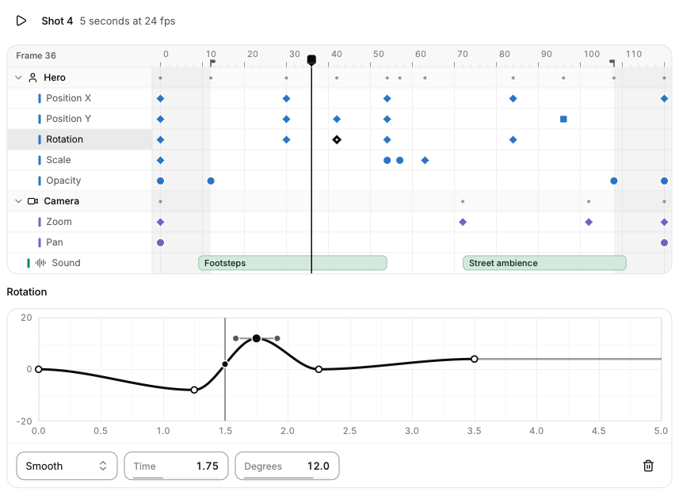

# Timeline editor

Use a timeline editor for animation keys and media clips. The gallery
shows a five-second shot at 24 frames per second, a play range and a curve
editor for the selected track. Available in **GUI**.



## Example

```pascal
unit Docs.Ui.EditingTools.TimelineEditor;

uses Fpas.Ui.Elements as E;
uses Fpas.Ui.Widgets.Editors.CurveEditors as C;
uses Fpas.Ui.Widgets.Editors.TimelineEditors as W;

// Builds an editable track with two keys.
// ## Returns
// A track for the initial application model.
public function Track(): W.Track;
begin
  return new W.Track('Opacity',
    Keys := [new W.Key(new C.Key(0.0F, 0.0F)), new W.Key(new C.Key(2.0F, 1.0F))],
    Capacity := 12);
end function;

// Displays the current shot.
// ## Parameters
// - `Tracks`: Model-owned tracks and their keys and clips.
// - `Current`: Playhead, viewport, selection and play range.
// ## Returns
// Timeline with edit and playback proposals.
public function View(Tracks: array of W.Track; Current: W.View): E.Element of W.Event;
begin
  return W.TimelineEditor of W.Event('shot', Tracks, Current,
    function(Change: W.Event): W.Event => Change,
    new W.Options(Finish := 5.0F, FramesPerSecond := 24.0F, Toggles := true));
end function;

end unit;
```

## Options and defaults

| Option | Default or requirement |
| --- | --- |
| `Track.Keys / Clips / Capacity` | Empty / empty / 0. Sort keys by time and supply sorted, non-overlapping clips. Positive Capacity allows inserting keys. |
| `Start / Finish / FramesPerSecond` | 0 / 10 / 30. Sequence times are in seconds. |
| `Labels` | Frames. Seconds and Timecode are also available. |
| `Height / RowHeight / TrackWidth` | All zero. Zero height fits rows. Other zeros use native dimensions. |
| `Toggles / FreeDrag` | Both false. Toggle buttons control mute and lock. FreeDrag disables frame snapping. |

## Interaction

Scrub the ruler to move the playhead and drag keys or clips to reschedule
them. Store `Tracks` and `Current` from the proposal. Space can request
playback via `TogglePlayback`. Run playback in the application and pass
the resulting time back in the view. To share a track with a curve editor,
use the track's curve keys and apply curve edits to that same track.

## See also

- [CUI widget inventory](../../../cui-widget-inventory.md#cui_timeline_editor)
- [Widget API and types](../../../../src/Fpas.Ui/Widgets/Editors/TimelineEditors.fpas)
- [Gallery example](../../../../examples/ui/gui/gallery/Pages/EditingTools/View.fpas)
- [Gallery update function](../../../../examples/ui/gui/gallery/Pages/EditingTools/Update.fpas)
- [Curve editor](curve-editor.md)
- [Editing tools](README.md)

## Source files

- `src/Fpas.Ui.Gui/Internal/Widgets/Editors/`
  - [TimelineEditor.fpas](../../../../src/Fpas.Ui.Gui/Internal/Widgets/Editors/TimelineEditor.fpas)
- `src/Fpas.Ui.Gui.Cui/Interop/Editors/`
  - [NativeMethods.TimelineEditor.cs](../../../../src/Fpas.Ui.Gui.Cui/Interop/Editors/NativeMethods.TimelineEditor.cs)
- `src/Fpas.Ui.Gui.Cui/Widgets/Editors/`
  - [CuiWindow.TimelineEditor.Types.cs](../../../../src/Fpas.Ui.Gui.Cui/Widgets/Editors/CuiWindow.TimelineEditor.Types.cs)
  - [CuiWindow.TimelineEditor.cs](../../../../src/Fpas.Ui.Gui.Cui/Widgets/Editors/CuiWindow.TimelineEditor.cs)
- `src/Fpas.Ui.Gui.Cui/native/widgets/editors/`
  - [timeline_editor.c](../../../../src/Fpas.Ui.Gui.Cui/native/widgets/editors/timeline_editor.c)
  - [timeline_editor.h](../../../../src/Fpas.Ui.Gui.Cui/native/widgets/editors/timeline_editor.h)
- `tests/Fpas.Ui.Gui.Cui.Tests/Display/`
  - [CuiTimelineTests.cs](../../../../tests/Fpas.Ui.Gui.Cui.Tests/Display/CuiTimelineTests.cs)
