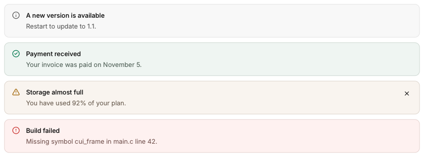

# Alert

Use an inline alert for an update, result or warning that belongs in the page. See also the [terminal alert](../../tui/feedback/alert.md).



## Example

```pascal
unit Docs.Ui.Feedback.Alert;

uses Fpas.Ui.Elements as E;
uses Fpas.Ui.Styles as S;
uses Fpas.Ui.Widgets.Feedback.Alerts as W;

// Builds the alert example.
// ## Returns
// The widget for the application view.
public function View(): E.Element of string;
begin
  return W.Alert of string('storage', 'Storage almost full',
    new W.Options(Description := 'You have used 92% of your plan.',
      Tone := S.Tone.Warning, Dismissible := true),
    function(): string => 'dismiss-storage');
end function;

end unit;
```

## Options and defaults

| Option | Default or requirement |
| --- | --- |
| `Description` | Null omits the supporting text. An empty string reserves a blank line in the GUI. |
| `Icon` | Null uses CUI's icon for the selected tone. An empty string draws no glyph. |
| `Tone` | `Neutral`. Also accepts `Info`, `Success`, `Warning`, `Danger`, `Violet`, `Teal`, `Rose` and `Accent`. |
| `Dismissible` | False. True adds a close control. |
| `Enabled` | True. False disables the close control. |
| `OnDismiss` | Optional message factory called once when the close action is used. |

## Interaction

Click the close button or focus it and press Enter or Space. CUI keeps the
alert hidden while the same ID remains in the view. Present a frame without the
alert to release its native dismissal state. Use `DismissId(Id)` to address the
close button.

## See also

- [CUI widget inventory](../../../cui-widget-inventory.md#cui_alert)
- [Widget API and types](../../../../src/Fpas.Ui/Widgets/Feedback/Alerts.fpas)
- [Gallery example](../../../../examples/ui/gui/gallery/Pages/Feedback/View.fpas)
- [Toast](../overlays/toast.md)
- [Feedback](README.md)

## Source files

- [Alert.fpas](../../../../src/Fpas.Ui.Gui/Internal/Widgets/Feedback/Alert.fpas)
