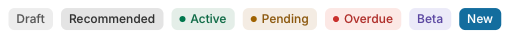

# Badge

Use a badge for a compact label such as Active, Pending or Overdue. Available in **GUI**.



## Example

```pascal
unit Docs.Ui.Feedback.Badge;

uses Fpas.Ui.Elements as E, Fpas.Ui.Widgets.Feedback.Badges as W,
  Fpas.Ui.Styles as S;

// Builds the badge example.
// ## Returns
// The widget for the application view.
public function View(): E.Element<string>;
begin
  return W.Badge<string>('badge-active', 'Active', new W.Options(Tone := S.Tone.Success, Dot := true));
end function;

end unit;
```

## Options and defaults

| Option | Default or requirement |
| --- | --- |
| `Text` | Literal caption. |
| `Tone / Size` | Neutral / Medium. |
| `Dot / Solid` | false / false. Dot adds a leading status marker. Solid uses a filled style. |
| `Icon` | Empty. Supply a CUI glyph for an icon. |

## Interaction

The badge displays a label and has no input action. Change the caption and tone when the model changes. Use a readable caption so the meaning is available without relying on color.

## See also

- [Widget API and types](../../../../src/Fpas.Ui/Widgets/Feedback/Badges.fpas)
- [Gallery example](../../../../examples/ui/gui/gallery/Pages/Feedback/Widgets/BadgesAndAvatars.fpas)
- [Chip](../selection/chip.md)
- [Feedback](README.md)
