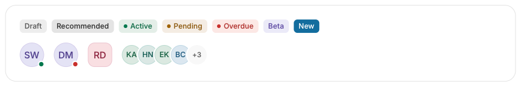

# Card

Use a card to place related content on a native surface. Available in **GUI**.



## Example

```pascal
unit Docs.Ui.Feedback.Card;

uses Fpas.Ui.Elements as E;
uses Fpas.Ui.Widgets.Containers.Cards as W;

// Builds the card example.
// ## Parameters
// - `Content`: Child view drawn by the card.
// ## Returns
// The widget for the application view.
public function View(Content: E.Element of string): E.Element of string;
begin
  return W.Card of string('badges-and-avatars-card', [Content], new W.Options(Gap := 16.0F));
end function;

end unit;
```

## Options and defaults

| Option | Default or requirement |
| --- | --- |
| `Width / Height` | Content / Content. |
| `MinimumWidth / MaximumWidth` | Both 0. Positive values set bounds in logical units. If both bounds are positive, the minimum must be at most the maximum. |
| `Padding / Gap` | Both 0. CUI uses 24 logical units for zero padding and 12 for a zero gap. |
| `PaddingX / PaddingY` | Both 0. Positive values override `Padding` for the horizontal or vertical axis. |
| `Horizontal / Align / Wrap` | false / Default / false. Set `Horizontal` to true to place children in a row. Only a horizontal card accepts `Wrap`. |
| `Muted / Selected / Enabled` | false / false / true. Muted uses a borderless surface, and Selected uses an accent border. |
| `OnActivate` | Optional callback that makes the card itself interactive. |
| `Hoverable` | false. Enable it to use a card without an activation callback as a hover card trigger. |

## Layout

Use `MinimumWidth` and `MaximumWidth` to constrain a card in a responsive
row. If the row wraps, CUI uses these bounds to choose which children fit
on a line. Set `Width` to `Fill` if the card can grow within its bounds.

## Interaction

Without an activation callback, the card groups its children. Focus and
activate an enabled card with a callback using the pointer or keyboard.
Child controls retain their own actions.

## See also

- [CUI widget inventory](../../../cui-widget-inventory.md#cui_card)
- [Widget API and types](../../../../src/Fpas.Ui/Widgets/Containers/Cards.fpas)
- [Gallery example](../../../../examples/ui/gui/gallery/Pages/Feedback/Widgets/BadgesAndAvatars.fpas)
- [Grid](grid.md)
- [Wrapping row](../layout/row.md)
- [Sizing](../../layout/sizing.md)
- [Expandable card](../disclosure/expandable-card.md)
- [Feedback](README.md)

## Source files

- `src/Fpas.Ui.Gui/Internal/Widgets/Containers/`
  - [Card.fpas](../../../../src/Fpas.Ui.Gui/Internal/Widgets/Containers/Card.fpas)
- `src/Fpas.Ui.Gui.Cui/Interop/Containers/`
  - [NativeMethods.Card.cs](../../../../src/Fpas.Ui.Gui.Cui/Interop/Containers/NativeMethods.Card.cs)
- `src/Fpas.Ui.Gui.Cui/Widgets/Containers/`
  - [CuiWindow.Card.cs](../../../../src/Fpas.Ui.Gui.Cui/Widgets/Containers/CuiWindow.Card.cs)
- `src/Fpas.Ui.Gui.Cui/native/widgets/containers/`
  - [card.c](../../../../src/Fpas.Ui.Gui.Cui/native/widgets/containers/card.c)
  - [card.h](../../../../src/Fpas.Ui.Gui.Cui/native/widgets/containers/card.h)
