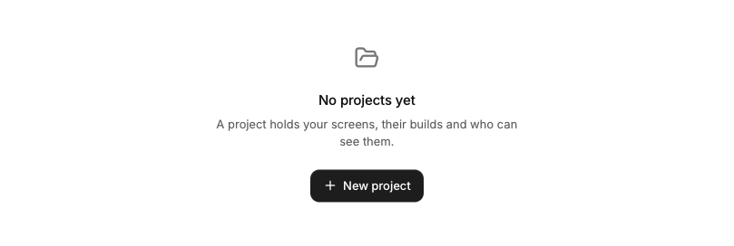

# Empty state

Use an empty state to explain an empty area and offer the next action when one is available. Available in **GUI**.



## Example

```pascal
unit Docs.Ui.Feedback.EmptyState;

uses Fpas.Ui.Elements as E;
uses Fpas.Ui.Widgets.Containers.EmptyStates as W;

// Builds the empty state example.
// ## Returns
// The widget for the application view.
public function View(): E.Element of string;
begin
  return W.EmptyState of string('no-projects', 'No projects yet',
    new W.Options(Description := 'Create a project to group screens and builds.', ActionLabel := 'New project'),
    function(): string => 'create-project');
end function;

end unit;
```

## Options and defaults

| Option | Default or requirement |
| --- | --- |
| `Title` | Literal heading. |
| `Description` | Null omits the supporting text. An empty string reserves a blank line. |
| `Icon` | Null omits the illustration. Supply a CUI glyph or an empty string to reserve a blank icon area. |
| `ActionLabel` | Null omits the action. An empty string shows a button with only its plus icon. |
| `OnAction` | Null. Supply a message factory with any action caption, including an empty caption. |
| `Enabled` | True. False disables the action button. |

## Interaction

The optional button sends the supplied message. Apply it in the update and
replace the empty state when the collection has content. Use `ActionId(Id)` to
address the button for focus. Press Enter or Space to activate the focused button.

## See also

- [CUI widget inventory](../../../cui-widget-inventory.md#cui_empty_state)
- [Widget API and types](../../../../src/Fpas.Ui/Widgets/Containers/EmptyStates.fpas)
- [Gallery example](../../../../examples/ui/gui/gallery/Pages/Feedback/View.fpas)
- [Feedback](README.md)

## Source files

- `src/Fpas.Ui.Gui/Internal/Widgets/Containers/`
  - [EmptyState.fpas](../../../../src/Fpas.Ui.Gui/Internal/Widgets/Containers/EmptyState.fpas)
- `src/Fpas.Ui.Gui.Cui/Interop/Containers/`
  - [NativeMethods.EmptyState.cs](../../../../src/Fpas.Ui.Gui.Cui/Interop/Containers/NativeMethods.EmptyState.cs)
- `src/Fpas.Ui.Gui.Cui/Widgets/Containers/`
  - [CuiWindow.EmptyState.cs](../../../../src/Fpas.Ui.Gui.Cui/Widgets/Containers/CuiWindow.EmptyState.cs)
- `src/Fpas.Ui.Gui.Cui/native/widgets/containers/`
  - [empty_state.c](../../../../src/Fpas.Ui.Gui.Cui/native/widgets/containers/empty_state.c)
  - [empty_state.h](../../../../src/Fpas.Ui.Gui.Cui/native/widgets/containers/empty_state.h)
