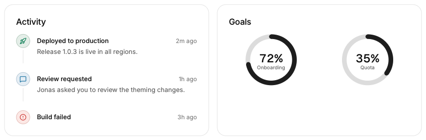

# Grid

Use a grid for equal-width columns with a fixed or responsive count. The
gallery places Activity and Goals side by side. Available in **GUI**.



## Example

```pascal
unit Docs.Ui.Feedback.Grid;

uses Fpas.Ui.Elements as E;
uses Fpas.Ui.Layout as L;
uses Fpas.Ui.Widgets.Containers.Grids as W;

// Builds the grid example.
// ## Parameters
// - `Activity`: Activity cell.
// - `Goals`: Goals cell.
// ## Returns
// The widget for the application view.
public function View(Activity: E.Element of string; Goals: E.Element of string): E.Element of string;
begin
  return W.Grid of string(
    new W.Options(Columns := 0, MinimumColumnWidth := 260.0F,
      Flow := new L.Flow(Gap := L.Spacing.Fixed(L.Measure.Logical(16)))),
    Activity, Goals);
end function;

end unit;
```

## Options and defaults

| Option | Default or requirement |
| --- | --- |
| `Columns` | Defaults to 1. Use a positive count for fixed columns or a responsive cap. Use 0 for a responsive cap equal to the child count. |
| `MinimumColumnWidth` | Defaults to 0 for fixed columns. Use a positive width in logical units for responsive columns. |
| `Flow` | `Layout.Flow` supplies common box options. If supplied, `Flow` supplies the gap and padding. |
| `Gap / Padding` | Both default to None and apply when `Flow` is omitted. |

## Column and row layout

CUI fits responsive columns into the width inside the grid padding. The count
includes room for gaps and has a minimum of one. If `Columns` and
`MinimumColumnWidth` are both zero, CUI uses one column. A single column can
be narrower than `MinimumColumnWidth`.

CUI places children in order, one row at a time. The tallest child sets the
row height. `Gap` separates columns and rows. A child with a fixed width keeps
its width at the cell origin. `ReadingDirection` controls the order of the
columns on screen.

Use `Elements.Size` to supply the grid's width, height or bounds. Set `Flow.Align`
to `Default`, `Flow.Justify` to `Start`, and `Flow.Wrap` to `false` on the grid.
Set alignment and justification on a row or column inside a cell to arrange
its content.

## See also

- [Widget API and types](../../../../src/Fpas.Ui/Widgets/Containers/Grids.fpas)
- [Common box options](../layout/column.md)
- [Sizing](../../layout/sizing.md)
- [Responsive layout](../../layout/responsive.md)
- [Gallery example](../../../../examples/ui/gui/gallery/Pages/Feedback/View.fpas)
- [Card](card.md)
- [Overview](../overview/README.md)
- [Feedback](README.md)

## Source files

- `src/Fpas.Ui.Gui/Internal/Widgets/Containers/`
  - [Grid.fpas](../../../../src/Fpas.Ui.Gui/Internal/Widgets/Containers/Grid.fpas)
- `src/Fpas.Ui.Gui.Cui/Interop/Containers/`
  - [NativeMethods.Grid.cs](../../../../src/Fpas.Ui.Gui.Cui/Interop/Containers/NativeMethods.Grid.cs)
- `src/Fpas.Ui.Gui.Cui/Widgets/Containers/`
  - [CuiWindow.Grid.cs](../../../../src/Fpas.Ui.Gui.Cui/Widgets/Containers/CuiWindow.Grid.cs)
- `src/Fpas.Ui.Gui.Cui/native/widgets/containers/`
  - [grid.c](../../../../src/Fpas.Ui.Gui.Cui/native/widgets/containers/grid.c)
  - [grid.h](../../../../src/Fpas.Ui.Gui.Cui/native/widgets/containers/grid.h)
- [FPAS layout contract](../../../../tests/Fixtures/gui-host/LayoutContract.fpas)
- [Native layout comparison](../../../../src/Fpas.Ui.Gui.Cui/native/tests/layout_parity.c)
