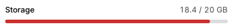

# Meter

Use a meter for usage relative to a capacity. The gallery shows storage in gigabytes. Available in **GUI**.



## Example

```pascal
unit Docs.Ui.Feedback.Meter;

uses Fpas.Ui.Elements as E;
uses Fpas.Ui.Widgets.Charts.Meters as W;

// Builds the meter example.
// ## Parameters
// - `Used`: Current usage in gigabytes.
// ## Returns
// The widget for the application view.
public function View(Used: float): E.Element of string;
begin
  return W.Meter of string('storage-usage', 'Storage', Used, 20.0F, 'GB');
end function;

end unit;
```

## Options and defaults

| Option | Default or requirement |
| --- | --- |
| `Label / Unit` | Literal text. Unit defaults to empty. |
| `Used / Total` | Finite nonnegative quantities. Used can exceed Total. |

## Interaction

CUI displays the used amount, total, and unit. It uses the warning color above
75% and the danger color above 90%. A zero total shows an empty track. Usage
above capacity fills the track and retains the reported amounts. The meter is
read-only.

## See also

- [CUI widget inventory](../../../cui-widget-inventory.md#cui_meter)
- [Widget API and types](../../../../src/Fpas.Ui/Widgets/Charts/Meters.fpas)
- [Gallery example](../../../../examples/ui/gui/gallery/Pages/Feedback/View.fpas)
- [Progress bar](progress-bar.md)
- [Feedback](README.md)

## Source files

- [Meter.fpas](../../../../src/Fpas.Ui.Gui/Internal/Widgets/Charts/Meter.fpas)
- [meter.c](../../../../src/Fpas.Ui.Gui.Cui/native/tests/meter.c)
- [CuiMeterTests.cs](../../../../tests/Fpas.Ui.Gui.Cui.Tests/Feedback/CuiMeterTests.cs)
