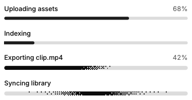

# Progress bar

Use a progress bar for a task with measurable progress or work that has no known total. Determinate progress is available in **GUI and TUI**.



## Example

```pascal
unit Docs.Ui.Feedback.ProgressBar;

uses Fpas.Ui.Elements as E, Fpas.Ui.Widgets.Feedback.ProgressBars as W;

// Builds the progress bar example.
// ## Parameters
// - `Fraction`: Current progress from zero through one.
// ## Returns
// The widget for the application view.
public function View(Fraction: float): E.Element<string>;
begin
  return W.ProgressBar<string>('upload', Fraction,
    new W.Options(Label := 'Uploading assets', ShowValue := true));
end function;

end unit;
```

## Options and defaults

| Option | Default or requirement |
| --- | --- |
| `Value` | A finite fraction from 0 through 1. |
| `Label / ShowValue` | Empty / false. ShowValue displays a rounded percentage for determinate progress. |
| `Indeterminate / Dither` | false / false. Indeterminate uses activity motion. Dither uses ordered dots for either mode. |
| `Tone / Height` | Neutral / 0. Zero uses CUI's default track height. |
| `Width` | Content uses CUI's full-width track. |

## Interaction

Pass the fraction from the application model and update it when the work reports progress. Set Indeterminate when a total is unavailable. CUI paints and interpolates the bar. It has no activation action. The TUI displays a one-row track with the optional
label and percentage above it. Fixed widths are clipped to the available cells.
Indeterminate mode, dither and custom track height require the GUI.

## See also

- [Widget API and types](../../../../src/Fpas.Ui/Widgets/Feedback/ProgressBars.fpas)
- [Gallery example](../../../../examples/ui/gui/gallery/Pages/Feedback/View.fpas)
- [Progress ring](progress-ring.md)
- [Meter](meter.md)
- [Feedback](README.md)
- [Terminal example](../../tui/feedback/progress-bar.md)
