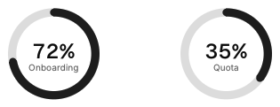

# Progress ring

Use a progress ring for a percentage with a short label inside the indicator. Available in **GUI**.



## Example

```pascal
unit Docs.Ui.Feedback.ProgressRing;

uses Fpas.Ui.Elements as E;
uses Fpas.Ui.Widgets.Feedback.ProgressRings as W;

// Builds the progress ring example.
// ## Parameters
// - `Fraction`: Current progress from zero through one.
// ## Returns
// The widget for the application view.
public function View(Fraction: float): E.Element of string;
begin
  return W.ProgressRing of string('onboarding', 'Onboarding', Fraction, 104.0F);
end function;

end unit;
```

## Options and defaults

| Option | Default or requirement |
| --- | --- |
| `Value` | A finite fraction from 0 through 1. |
| `Label` | A literal caption. Pass an empty string to omit it. |
| `Size` | 0 uses CUI's 96-point default. A positive value sets the logical diameter. |

## Interaction

CUI formats the percentage and interpolates the ring as the model changes. The ring keeps its diameter within the surrounding layout and has no input action.

## See also

- [CUI widget inventory](../../../cui-widget-inventory.md#cui_progress_ring)
- [Widget API and types](../../../../src/Fpas.Ui/Widgets/Feedback/ProgressRings.fpas)
- [Gallery example](../../../../examples/ui/gui/gallery/Pages/Feedback/View.fpas)
- [Progress bar](progress-bar.md)
- [Feedback](README.md)

## Source files

- [ProgressRing.fpas](../../../../src/Fpas.Ui.Gui/Internal/Widgets/Feedback/ProgressRing.fpas)
- [progress_ring.c](../../../../src/Fpas.Ui.Gui.Cui/native/tests/progress_ring.c)
- [CuiProgressRingTests.cs](../../../../tests/Fpas.Ui.Gui.Cui.Tests/Feedback/CuiProgressRingTests.cs)
