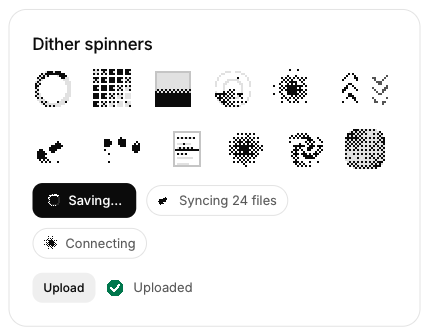

# Spinner

Use a spinner to indicate work in progress when the total is unavailable. The gallery shows three sizes and several animation styles. See the [terminal spinner](../../tui/feedback/spinner.md).




## Example

```pascal
unit Docs.Ui.Feedback.Spinner;

uses Fpas.Ui.Elements as E;
uses Fpas.Ui.Widgets.Feedback.Spinners as W;

// Builds the spinner example.
// ## Returns
// The widget for the application view.
public function View(): E.Element of string;
begin
  return W.Spinner of string('syncing', 22.0F, new W.Options(Animation := W.Style.Orbit));
end function;

end unit;
```

## Options and defaults

| Option | Default or requirement |
| --- | --- |
| `Size` | A finite nonnegative height. Zero uses the native 20-unit default. |
| `Animation` | `Arc`. The other styles draw dots. |
| `Color` / `ThemeColor` | Choose an RGBA ink color or an active theme token. The arc defaults to secondary text color. Dotted styles default to foreground. |
| `Track` / `ThemeTrack` | Choose an RGBA track color or an active theme token for dotted styles. The default uses the ink color at 12% opacity. |

## Interaction

CUI calculates width from the style's aspect ratio. CUI draws a still frame
when the window uses reduced motion. A visible dotted spinner requests a new
frame when its dots change. Include the spinner in the view while work runs.

## See also

- [CUI widget inventory](../../../cui-widget-inventory.md#cui_spinner)
- [Widget API and types](../../../../src/Fpas.Ui/Widgets/Feedback/Spinners.fpas)
- [Gallery example](../../../../examples/ui/gui/gallery/Pages/Feedback/Widgets/Loading.fpas)
- [Status spinner](status-spinner.md)
- [Feedback](README.md)

## Source files

- [Spinner.fpas](../../../../src/Fpas.Ui.Gui/Internal/Widgets/Feedback/Spinner.fpas)
