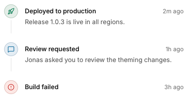

# Timeline item

Use timeline items in an activity feed to show an event, its time and optional details. Available in **GUI**.



## Example

```pascal
unit Docs.Ui.Feedback.TimelineItem;

uses Fpas.Ui.Elements as E;
uses Fpas.Ui.Styles as S;
uses Fpas.Ui.Widgets.Planning.TimelineItems as W;

// Builds the timeline item example.
// ## Returns
// The widget for the application view.
public function View(): E.Element of string;
begin
  return W.TimelineItem of string('deployed', 'Deployed to production',
    new W.Options(Time := '2m ago', Description := 'Release 1.0.3 is live.',
      Tone := S.Tone.Success, Last := true));
end function;

end unit;
```

## Options and defaults

| Option | Default or requirement |
| --- | --- |
| `Title` | A nonempty literal heading. |
| `Time / Description` | Empty. Format any timestamp in the application before passing the caption. |
| `Icon / Tone` | Empty uses CUI's dot. The tone defaults to Neutral. |
| `Last` | false. Set true on the final item to omit its connector and trailing space. |

## Interaction

Place items in the order the reader should see them. CUI wraps the text and aligns the title and time. A timeline item has no activation action.

## See also

- [Widget API and types](../../../../src/Fpas.Ui/Widgets/Planning/TimelineItems.fpas)
- [Gallery example](../../../../examples/ui/gui/gallery/Pages/Feedback/View.fpas)
- [Feedback](README.md)

## Source files

- [TimelineItem.fpas](../../../../src/Fpas.Ui.Gui/Internal/Widgets/Planning/TimelineItem.fpas)
- [timeline.c](../../../../src/Fpas.Ui.Gui.Cui/native/tests/timeline.c)
