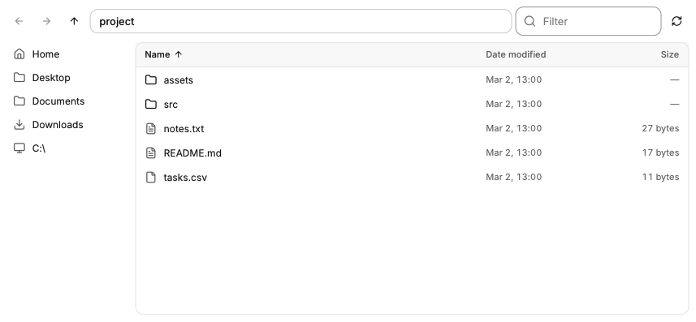

# File browser

Use a file browser to navigate folders inside a view. The gallery shows
directory history, a path bar, a filename filter and a sortable listing.
Available in **GUI**.



## Example

```pascal
unit Docs.Ui.Files.FileBrowser;

uses Fpas.Ui.Elements as E;
uses Fpas.Ui.Layout as L;
uses Fpas.Ui.Widgets.Files.FileBrowsers as W;

// Shows the currently open project folder.
// ## Parameters
// - `Folder`: Current directory stored by the application.
// ## Returns
// The browser with folder, selection and activation proposals.
public function View(Folder: string): E.Element of W.Event;
begin
  return W.FileBrowser of W.Event('project-files', Folder,
    function(Change: W.Event): W.Event => Change,
    new W.Options(Height := L.Extent.Fixed(L.Measure.Logical(380)),
      Filter := '*.md;*.txt'));
end function;

end unit;
```

## Options and defaults

| Option | Default or requirement |
| --- | --- |
| `Width / Height` | Fill / Content. Content uses the native height. |
| `Filter / FoldersOnly / Hidden` | Empty / false / false. A filter is a semicolon-separated list of glob patterns. |
| `Places / NoPlaces` | Empty / false. The empty list uses CUI's default places. |
| `Source / Revision` | null / 0. Null lists local disk. With a provider, change Revision to refresh a changed listing for the same folder. |
| `MaximumEntries / Enabled` | 0 / true. Zero uses the native limit. |

## Interaction

Double-click to enter a folder or activate a file. Type to jump within the
listing and use Backspace to go up. Store `Event.Folder` to follow navigation.
`Selected` reports the selection and `Picked` identifies an activated file.
A custom provider receives a path and the hidden-file flag. Return null for
an unreadable folder, which the browser reports with `Event.Error`.

## See also

- [CUI widget inventory](../../../cui-widget-inventory.md#cui_file_browser)
- [Widget API and types](../../../../src/Fpas.Ui/Widgets/Files/FileBrowsers.fpas)
- [Listing types](../../../../src/Fpas.Ui/Widgets/Files/FileListings.fpas)
- [Gallery example](../../../../examples/ui/gui/gallery/Pages/Files/View.fpas)
- [Files](README.md)

## Source files

- `src/Fpas.Ui.Gui/Internal/Widgets/Files/`
  - [FileBrowser.fpas](../../../../src/Fpas.Ui.Gui/Internal/Widgets/Files/FileBrowser.fpas)
- `src/Fpas.Ui.Gui.Cui/Interop/Files/`
  - [NativeMethods.FileBrowser.cs](../../../../src/Fpas.Ui.Gui.Cui/Interop/Files/NativeMethods.FileBrowser.cs)
- `src/Fpas.Ui.Gui.Cui/Widgets/Files/`
  - [CuiWindow.FileBrowser.Types.cs](../../../../src/Fpas.Ui.Gui.Cui/Widgets/Files/CuiWindow.FileBrowser.Types.cs)
  - [CuiWindow.FileBrowser.cs](../../../../src/Fpas.Ui.Gui.Cui/Widgets/Files/CuiWindow.FileBrowser.cs)
- `src/Fpas.Ui.Gui.Cui/native/widgets/files/`
  - [file_browser.c](../../../../src/Fpas.Ui.Gui.Cui/native/widgets/files/file_browser.c)
  - [file_browser.h](../../../../src/Fpas.Ui.Gui.Cui/native/widgets/files/file_browser.h)
