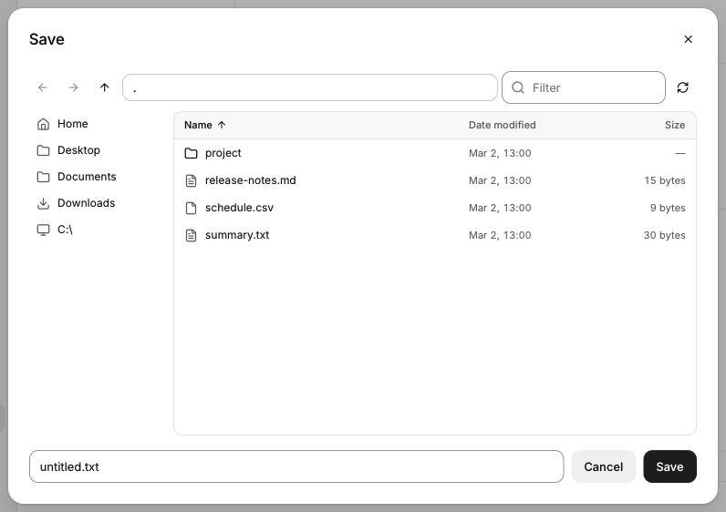

# File picker

Use a file picker to open a file, name a save destination or choose a folder.
The gallery opens Open and Save as dialogs over the file browser.
Available in **GUI**.


## Example

```pascal
unit Docs.Ui.Files.FilePicker;

uses Fpas.Ui.Elements as E, Fpas.Ui.Widgets.Files.FilePickers as W;

// Opens the Save as picker over an existing view.
// ## Parameters
// - `Base`: View drawn behind the picker.
// - `Open`: Visibility stored in the model.
// ## Returns
// The view with the picker and its result message.
public function View(Base: E.Element<W.Event>; Open: bool): E.Element<W.Event>;
begin
  return W.FilePicker<W.Event>('save-report', Open,
    function(Choice: W.Event): W.Event => Choice,
    new W.Options(Kind := W.Mode.SaveFile, Title := 'Save report',
      Name := 'report.txt', Filter := '*.txt'), Base);
end function;

end unit;
```

## Options and defaults

| Option | Default or requirement |
| --- | --- |
| `Kind` | OpenFile. SaveFile adds the name field and Folder selects a directory. |
| `Title / Start / Name` | All empty. The native title follows the mode and an empty Start uses the current directory. |
| `Filter / FilterLabel` | Both empty. Use semicolon-separated glob patterns and an optional label. |
| `Source / Base` | Both null. The default source lists local disk. Supply Base to draw a view under the modal. |

## Interaction

Set `Open` in the model to show the CUI modal. On a result, clear `Open` and
handle the path if present. Cancel or Escape dismisses the active picker and
returns null. OpenFile returns the existing selection, and SaveFile returns
a path to use in the application's save operation.



## See also

- [Widget API and types](../../../../src/Fpas.Ui/Widgets/Files/FilePickers.fpas)
- [Gallery example](../../../../examples/ui/gui/gallery/Pages/Files/View.fpas)
- [Gallery update function](../../../../examples/ui/gui/gallery/Pages/Files/Update.fpas)
- [Files](README.md)
