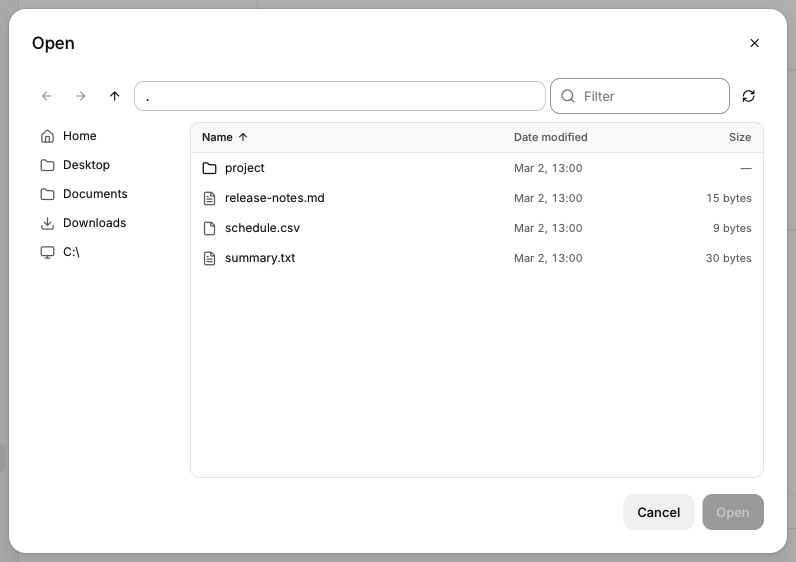

# File picker

Use a file picker to open a file, name a save destination or choose a folder.
The gallery opens Open and Save as dialogs over the file browser.
Available in **GUI** and [**TUI**](../../tui/files/file-picker.md).



## Example

```pascal
unit Docs.Ui.Files.FilePicker;

uses Fpas.Ui.Elements as E;
uses Fpas.Ui.Widgets.Files.FilePickers as W;

// Opens the Save as picker over an existing view.
// ## Parameters
// - `Base`: View drawn behind the picker.
// - `Open`: Visibility stored in the model.
// ## Returns
// The view with the picker and its result message.
public function View(Base: E.Element of W.Event; Open: bool): E.Element of W.Event;
begin
  return W.FilePicker of W.Event('save-report', Open,
    function(Choice: W.Event): W.Event => Choice,
    new W.Options(Kind := W.Mode.SaveFile, Title := 'Save report',
      Name := 'report.txt', Filter := '*.txt'), Base);
end function;

end unit;
```

## Options and defaults

| Option | Default or requirement |
| --- | --- |
| `Kind` | OpenFile. SaveFile adds the name field and Folder selects a directory. |
| `Title / Start / Name` | All empty. The default title follows the mode and an empty Start uses the current directory. |
| `Filter / FilterLabel` | Both empty. Use semicolon-separated glob patterns and an optional label. |
| `Source` | Null. CUI reads the local directory through `cui_fs_list`. Supply a synchronous provider for a different file tree. |
| `Base` | Null. Supply a view to draw under the modal. |

## Interaction

Set `Open` in the model to show the CUI modal. The callback receives an `Event`.
Clear `Open` and handle `Event.Path` when it has a value. Cancel or Escape sends
an event with `Path = null`. OpenFile supplies the existing selection, and
SaveFile supplies a path for the application's save operation.

In OpenFile mode, a filter change clears a selection when the file no longer
matches. In SaveFile mode, the filter applies to the listing. The save name
remains available for editing and confirmation.


## See also

- [CUI widget inventory](../../../cui-widget-inventory.md#cui_file_picker)
- [Widget API and types](../../../../src/Fpas.Ui/Widgets/Files/FilePickers.fpas)
- [Gallery example](../../../../examples/ui/gui/gallery/Pages/Files/View.fpas)
- [Gallery update function](../../../../examples/ui/gui/gallery/Pages/Files/Update.fpas)
- [Terminal file picker](../../tui/files/file-picker.md)
- [Files](README.md)

## Source files

- [Shared picker API](../../../../src/Fpas.Ui/Widgets/Files/FilePickers.fpas)
- [Shared picker examples and data](../../../../examples/ui/gui/gallery/Shared/FilePickerExample.fpas)
- `src/Fpas.Ui.Gui/Internal/Widgets/Files/`
  - [FilePicker.fpas](../../../../src/Fpas.Ui.Gui/Internal/Widgets/Files/FilePicker.fpas)
- `src/Fpas.Ui.Gui.Cui/Interop/Files/`
  - [NativeMethods.FilePicker.cs](../../../../src/Fpas.Ui.Gui.Cui/Interop/Files/NativeMethods.FilePicker.cs)
- `src/Fpas.Ui.Gui.Cui/Widgets/Files/`
  - [CuiWindow.FilePicker.Types.cs](../../../../src/Fpas.Ui.Gui.Cui/Widgets/Files/CuiWindow.FilePicker.Types.cs)
  - [CuiWindow.FilePicker.cs](../../../../src/Fpas.Ui.Gui.Cui/Widgets/Files/CuiWindow.FilePicker.cs)
- `src/Fpas.Ui.Gui.Cui/native/widgets/files/`
  - [file_picker.c](../../../../src/Fpas.Ui.Gui.Cui/native/widgets/files/file_picker.c)
  - [file_picker.h](../../../../src/Fpas.Ui.Gui.Cui/native/widgets/files/file_picker.h)
- `tests/Fpas.Ui.Gui.Cui.Tests/Packaging/`
  - [LinuxFileDialogInput.cs](../../../../tests/Fpas.Ui.Gui.Cui.Tests/Packaging/LinuxFileDialogInput.cs)
- `tests/Fpas.Ui.Gui.Cui.Tests/Windowing/`
  - [CuiFileDialogTests.cs](../../../../tests/Fpas.Ui.Gui.Cui.Tests/Windowing/CuiFileDialogTests.cs)
  - [WindowsFileDialogInput.cs](../../../../tests/Fpas.Ui.Gui.Cui.Tests/Windowing/WindowsFileDialogInput.cs)
