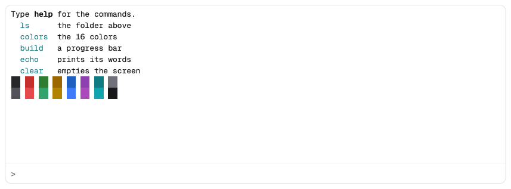

# Terminal

Use Terminal for an ANSI output panel with command input. The gallery
implements demo commands for help, colors and progress. Available in **GUI**.



## Example

```pascal
unit Docs.Ui.Files.Terminal;

uses Fpas.Ui.Elements as E;
uses Fpas.Ui.Widgets.Developer.Terminals as W;

// Builds a terminal for commands handled by the application.
// ## Parameters
// - `Output`: Cumulative ANSI output.
// - `Revision`: Current scrollback reset revision.
// ## Returns
// The terminal with submitted commands and interrupts as messages.
public function View(Output: string; Revision: int): E.Element of W.Event;
begin
  return W.Terminal of W.Event('commands', Output, Revision,
    function(Input: W.Event): W.Event => Input,
    new W.Options(Height := 300.0F, Prompt := '> '));
end function;

end unit;
```

## Options and defaults

| Option | Default or requirement |
| --- | --- |
| `Width / Height / Size` | Fill / 0 / 0. Zero uses 320 logical units for height and 13 for font size. A height of minus one fills the available space. |
| `Prompt / Input` | `'$ '` / true. Set Input to false for an output panel. |
| `ByteCapacity` | 65536. Allocate at least 64 bytes for native UTF-8 output. |
| `LineCapacity` | 1024. Allocate at least two slots, including the current line. |
| `Output / Revision` | Append to the cumulative output. Change Revision to clear native scrollback and replay the supplied output. |

## Output

Append text to the application's cumulative output. Format values in FPAS
before appending. CUI drops older lines when the scrollback reaches its byte
or line capacity. Changing a capacity rebuilds the scrollback from the
cumulative output.

The widget wraps long lines and follows new output until the user scrolls up.
Use a newline to start a line and a carriage return to overwrite progress on
the current line. CUI supports ANSI palette and RGB colors, bold, dim text,
underline and inverse colors.

## Interaction

CUI echoes submitted lines. Use Up and Down to navigate command history.
Drag to select output and use the system copy shortcut to copy the selection.
Ctrl+C without a selection sends `Event.Interrupt`. Enter sends
`Event.Command` when the input line is active.

Ctrl+L clears the native scrollback. To reset the application's output, supply
an empty output and a new revision. Handle command and interrupt messages in
the application update.

## See also

- [CUI widget inventory](../../../cui-widget-inventory.md#cui_terminal)
- [Widget API and types](../../../../src/Fpas.Ui/Widgets/Developer/Terminals.fpas)
- [Gallery widget](../../../../examples/ui/gui/gallery/Pages/Files/View.fpas)
- [Gallery command handling](../../../../examples/ui/gui/gallery/Pages/Files/Terminal.fpas)
- [Files](README.md)

## Source files

- `src/Fpas.Ui/Widgets/Developer/`
  - [Terminal.fpas](../../../../src/Fpas.Ui/Widgets/Developer/Terminal.fpas)
  - [Terminals.fpas](../../../../src/Fpas.Ui/Widgets/Developer/Terminals.fpas)
- `src/Fpas.Ui.Gui/Internal/Widgets/Developer/`
  - [Terminal.fpas](../../../../src/Fpas.Ui.Gui/Internal/Widgets/Developer/Terminal.fpas)
- `src/Fpas.Ui.Gui.Cui/Interop/Developer/`
  - [NativeMethods.Terminal.cs](../../../../src/Fpas.Ui.Gui.Cui/Interop/Developer/NativeMethods.Terminal.cs)
- `src/Fpas.Ui.Gui.Cui/Widgets/Developer/`
  - [CuiWindow.Terminal.Types.cs](../../../../src/Fpas.Ui.Gui.Cui/Widgets/Developer/CuiWindow.Terminal.Types.cs)
  - [CuiWindow.Terminal.cs](../../../../src/Fpas.Ui.Gui.Cui/Widgets/Developer/CuiWindow.Terminal.cs)
- `src/Fpas.Ui.Gui.Cui/native/widgets/developer/`
  - [terminal.c](../../../../src/Fpas.Ui.Gui.Cui/native/widgets/developer/terminal.c)
  - [terminal.h](../../../../src/Fpas.Ui.Gui.Cui/native/widgets/developer/terminal.h)
- [Native source tools tests](../../../../src/Fpas.Ui.Gui.Cui/native/tests/source_tools.c)
