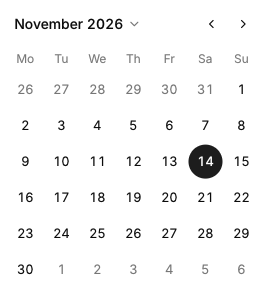

# Calendar

Use a calendar to leave single-date selection visible. The gallery shares its selection with the Due date field. Available in **GUI**.



## Example

```pascal
unit Docs.Ui.Inputs.Calendar;

uses Fpas.Ui.Elements as E, Fpas.Ui.Widgets.Pickers.Calendars as W,
  System as Sys;

// Builds the calendar example.
// ## Parameters
// - `Due`: Current value from the application model.
// ## Returns
// The widget for the application view.
public function View(Due: Sys.DateOnly?): E.Element<Sys.DateOnly>;
begin
  return W.Calendar<Sys.DateOnly>('input-calendar', Due, function(Value: Sys.DateOnly): Sys.DateOnly => Value);
end function;

end unit;
```

## Options and defaults

| Option | Default or requirement |
| --- | --- |
| `Value` | A System.DateOnly, or null for no selection. |
| `Enabled` | true. |

## Interaction

Choose a day to propose a date. The title switches from days to twelve months and then to twelve years. Choosing a year returns to the months. Choosing a month returns to days without changing the selected date. The calendar keeps its own displayed month. Use `TitleId`, `MonthId` and `DayId` to address visible controls.

## See also

- [Widget API and types](../../../../src/Fpas.Ui/Widgets/Pickers/Calendars.fpas)
- [Gallery example](../../../../examples/ui/gui/gallery/Pages/Inputs/Widgets/InlineCalendar.fpas)
- [Date picker](date-picker.md)
- [Inputs](README.md)
