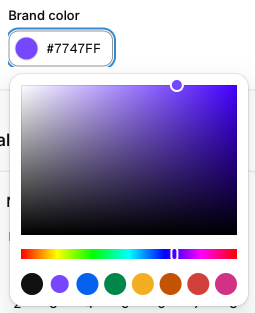

# Color picker

Use a color picker for a swatch the user can edit. In the gallery it sets the brand color. Available in **GUI**.



## Example

```pascal
unit Docs.Ui.Inputs.ColorPicker;

uses Fpas.Ui.Elements as E;
uses Fpas.Ui.Graphics as G;
uses Fpas.Ui.Widgets.Pickers.ColorPickers as W;

// Builds the color picker example.
// ## Parameters
// - `Brand`: Current value from the application model.
// ## Returns
// The widget for the application view.
public function View(Brand: G.Color): E.Element of G.Color;
begin
  return W.ColorPicker of G.Color('input-brand-color', Brand, function(Value: G.Color): G.Color => Value);
end function;

end unit;
```

## Options and defaults

| Option | Default or requirement |
| --- | --- |
| `Value` | A Fpas.Ui.Graphics.Color. The picker changes RGB and preserves the model's alpha. |
| `Enabled` | true. |

## Interaction

Click the swatch or press Enter or Space while the swatch has focus.
Use the hue strip, the saturation and value surface, or one of eight presets.
The callback receives the proposed color. Escape closes the palette and
returns focus to the swatch. Disabling the control closes its palette.

Use `ColorPickers.HueId`, `SurfaceId`, and `PresetId` to find parts in the
frame snapshot while the palette is open. Preset indices run from zero to seven.

## See also

- [CUI widget inventory](../../../cui-widget-inventory.md#cui_color_picker)
- [Widget API and types](../../../../src/Fpas.Ui/Widgets/Pickers/ColorPickers.fpas)
- [Gallery example](../../../../examples/ui/gui/gallery/Pages/Inputs/Widgets/BrandColor.fpas)
- [Inputs](README.md)

## Source files

- `src/Fpas.Ui.Gui/Internal/Widgets/Pickers/`
  - [ColorPicker.fpas](../../../../src/Fpas.Ui.Gui/Internal/Widgets/Pickers/ColorPicker.fpas)
- `src/Fpas.Ui.Gui.Cui/Interop/Pickers/`
  - [NativeMethods.ColorPicker.cs](../../../../src/Fpas.Ui.Gui.Cui/Interop/Pickers/NativeMethods.ColorPicker.cs)
- `src/Fpas.Ui.Gui.Cui/Widgets/Pickers/`
  - [CuiWindow.ColorPicker.Types.cs](../../../../src/Fpas.Ui.Gui.Cui/Widgets/Pickers/CuiWindow.ColorPicker.Types.cs)
  - [CuiWindow.ColorPicker.cs](../../../../src/Fpas.Ui.Gui.Cui/Widgets/Pickers/CuiWindow.ColorPicker.cs)
- `src/Fpas.Ui.Gui.Cui/native/widgets/pickers/`
  - [color_picker.c](../../../../src/Fpas.Ui.Gui.Cui/native/widgets/pickers/color_picker.c)
  - [color_picker.h](../../../../src/Fpas.Ui.Gui.Cui/native/widgets/pickers/color_picker.h)
