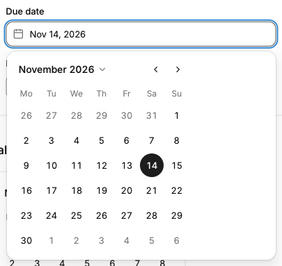

# Date picker

Use a date picker when a single date belongs in a form. The gallery shows the Due date field with its calendar open. Available in **GUI**.



## Example

```pascal
unit Docs.Ui.Inputs.DatePicker;

uses Fpas.Ui.Elements as E;
uses Fpas.Ui.Widgets.Pickers.DatePickers as W;
uses System as Sys;

// Builds the date picker example.
// ## Parameters
// - `Due`: Current value from the application model.
// ## Returns
// The widget for the application view.
public function View(Due: Sys.DateOnly?): E.Element of Sys.DateOnly;
begin
  return W.DatePicker of Sys.DateOnly('input-due-date', Due, function(Value: Sys.DateOnly): Sys.DateOnly => Value,
    new W.Options(Label := 'Due date'));
end function;

end unit;
```

## Options and defaults

| Option | Default or requirement |
| --- | --- |
| `Value` | A System.DateOnly, or null for an empty field. |
| `Label` | Empty omits the caption above the field. |
| `Placeholder` | Null uses “Pick a date”. An empty string omits the placeholder. |
| `Width` | Content uses CUI's default. Fill, Fixed, and Percent select the native width. |
| `Enabled` | true. |

## Interaction

Click the field or press Enter or Space while the field has focus.
Choose a day to propose a date and close the popup. Escape dismisses the
calendar and restores focus to the field. Browsing months or years keeps the
selected date. Set the model value to null to clear the field.

With Content width, a labeled date field fills its container. An unlabeled
date field has a preferred width of 220 logical units. For weighted growth,
use `Elements.Size` with `AxisSize.Grow`.

## See also

- [CUI widget inventory](../../../cui-widget-inventory.md#cui_date_picker)
- [Widget API and types](../../../../src/Fpas.Ui/Widgets/Pickers/DatePickers.fpas)
- [Gallery example](../../../../examples/ui/gui/gallery/Pages/Inputs/Widgets/PickerFields.fpas)
- [Calendar](calendar.md)
- [Sizing and units](../../layout/sizing.md)
- [Inputs](README.md)

## Source files

- `src/Fpas.Ui.Gui/Internal/Widgets/Pickers/`
  - [DatePicker.fpas](../../../../src/Fpas.Ui.Gui/Internal/Widgets/Pickers/DatePicker.fpas)
- `src/Fpas.Ui.Gui.Cui/Interop/Pickers/`
  - [NativeMethods.DatePicker.cs](../../../../src/Fpas.Ui.Gui.Cui/Interop/Pickers/NativeMethods.DatePicker.cs)
- `src/Fpas.Ui.Gui.Cui/Widgets/Pickers/`
  - [CuiWindow.DatePicker.cs](../../../../src/Fpas.Ui.Gui.Cui/Widgets/Pickers/CuiWindow.DatePicker.cs)
- `src/Fpas.Ui.Gui.Cui/native/widgets/pickers/`
  - [date_picker.c](../../../../src/Fpas.Ui.Gui.Cui/native/widgets/pickers/date_picker.c)
  - [date_picker.h](../../../../src/Fpas.Ui.Gui.Cui/native/widgets/pickers/date_picker.h)
- `tests/Fixtures/gui-host/`
  - [DateCalendarContract.fpas](../../../../tests/Fixtures/gui-host/DateCalendarContract.fpas)
