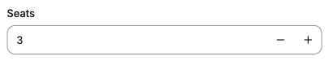

# Number field

Use a number field for a bounded numeric value that the user can type or step up and down. See also the [terminal number field](../../tui/inputs/number-field.md).



## Example

```pascal
unit Docs.Ui.Inputs.NumberField;

uses Fpas.Ui.Elements as E;
uses Fpas.Ui.Widgets.Inputs.NumberFields as W;

// Builds the number field example.
// ## Parameters
// - `Seats`: Current seat count from 0 through 99.
// ## Returns
// The widget for the application view.
public function View(Seats: double): E.Element of double;
requires Seats >= 0.0 and Seats <= 99.0;
begin
  return W.NumberField of double('input-seats', Seats, 0.0, 99.0,
    function(Value: double): double => Value, new W.Options(Label := 'Seats'));
end function;

end unit;
```

## Options and defaults

| Option | Default or requirement |
| --- | --- |
| `Value / Minimum / Maximum` | Finite doubles. The value must fall within the inclusive bounds. At the chosen precision, each formatted number can use up to 63 characters. |
| `Label / Suffix` | Empty. The suffix displays units beside the editor. |
| `Step` | 1.0. Supply a finite nonnegative increment. Zero uses one. |
| `DecimalPlaces` | 0. Choose 0 through 61 within the display buffer limit. |
| `Enabled` | true. |
| `Width` | Null uses CUI's preferred width of 160 logical units. Set `Fill`, `Fixed`, or `Percent` to override the width. |

## Interaction

Type a complete finite number or use the step buttons or arrow keys. Shift
with an arrow applies ten steps. The adapter clamps the proposal to the bounds.
Enter or loss of focus refreshes the displayed value. Changing the model value
or `DecimalPlaces` also reformats the text while the field has focus and resets
the editor's selection and undo history. Display precision does not round the
value stored in the model. Use `DecreaseId(Id)` and `IncreaseId(Id)` to identify
the buttons.

## See also

- [CUI widget inventory](../../../cui-widget-inventory.md#cui_number)
- [Widget API and types](../../../../src/Fpas.Ui/Widgets/Inputs/NumberFields.fpas)
- [Gallery example](../../../../examples/ui/gui/gallery/Pages/Inputs/Widgets/PickerFields.fpas)
- [Inputs](README.md)

## Source files

- `src/Fpas.Ui.Gui/Internal/Widgets/Inputs/`
  - [NumberField.fpas](../../../../src/Fpas.Ui.Gui/Internal/Widgets/Inputs/NumberField.fpas)
- `src/Fpas.Ui.Gui.Cui/Interop/Inputs/`
  - [NativeMethods.NumberField.cs](../../../../src/Fpas.Ui.Gui.Cui/Interop/Inputs/NativeMethods.NumberField.cs)
- `src/Fpas.Ui.Gui.Cui/Widgets/Inputs/`
  - [CuiWindow.NumberField.cs](../../../../src/Fpas.Ui.Gui.Cui/Widgets/Inputs/CuiWindow.NumberField.cs)
- `src/Fpas.Ui.Gui.Cui/native/widgets/inputs/`
  - [number_field.c](../../../../src/Fpas.Ui.Gui.Cui/native/widgets/inputs/number_field.c)
  - [number_field.h](../../../../src/Fpas.Ui.Gui.Cui/native/widgets/inputs/number_field.h)
