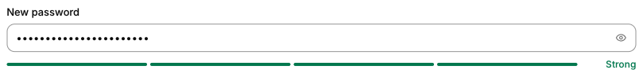

# Password strength meter

Put a password strength meter below a password field to display CUI's strength estimate for the current draft. Available in **GUI**.



## Example

```pascal
unit Docs.Ui.Inputs.PasswordStrength;

uses Fpas.Ui.Elements as E;
uses Fpas.Ui.Widgets.Inputs.PasswordStrengthMeters as W;

// Builds the password strength meter example.
// ## Parameters
// - `Password`: Current value from the application model.
// ## Returns
// The widget for the application view.
public function View(Password: string): E.Element of string;
begin
  return W.PasswordStrengthMeter of string('input-password-strength', Password);
end function;

end unit;
```

## Options and defaults

| Option | Default or requirement |
| --- | --- |
| `Password` | Pass the same model value used by the password field. |
| `Score` | CUI computes a score from 0 through 4 and selects the label. |

## Interaction

The meter is read-only. When the editor proposes a change, update the password in the model and pass it to both widgets in the next view. The GUI snapshot reports the strength label and score.

## See also

- [Widget API and types](../../../../src/Fpas.Ui/Widgets/Inputs/PasswordStrengthMeters.fpas)
- [Gallery example](../../../../examples/ui/gui/gallery/Pages/Inputs/Widgets/CredentialFields.fpas)
- [Inputs](README.md)

## Source files

- `src/Fpas.Ui.Gui/Internal/Widgets/Inputs/`
  - [PasswordStrength.fpas](../../../../src/Fpas.Ui.Gui/Internal/Widgets/Inputs/PasswordStrength.fpas)
- `src/Fpas.Ui.Gui.Cui/Interop/Inputs/`
  - [NativeMethods.PasswordStrength.cs](../../../../src/Fpas.Ui.Gui.Cui/Interop/Inputs/NativeMethods.PasswordStrength.cs)
- `src/Fpas.Ui.Gui.Cui/Widgets/Inputs/`
  - [CuiWindow.PasswordStrength.cs](../../../../src/Fpas.Ui.Gui.Cui/Widgets/Inputs/CuiWindow.PasswordStrength.cs)
- `src/Fpas.Ui.Gui.Cui/native/widgets/inputs/`
  - [password_strength.c](../../../../src/Fpas.Ui.Gui.Cui/native/widgets/inputs/password_strength.c)
  - [password_strength.h](../../../../src/Fpas.Ui.Gui.Cui/native/widgets/inputs/password_strength.h)
