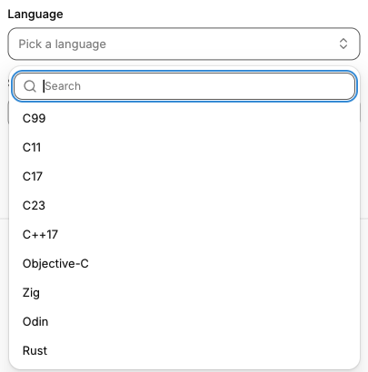

# Select

Use Select for one choice from a list. Enable search to filter a longer list inside its popup. Available in **GUI**.



## Example

```pascal
unit Docs.Ui.Inputs.Select;

uses Fpas.Ui.Elements as E, Fpas.Ui.Widgets.Inputs.Selects as W;

// Builds the select example.
// ## Parameters
// - `Selected`: Current value from the application model.
// ## Returns
// The widget for the application view.
public function View(Selected: int): E.Element<int>;
begin
  return W.Select<int>('input-language', [new W.Item('C'), new W.Item('Zig'), new W.Item('Rust')],
    Selected, function(Index: int): int => Index,
    new W.Options(Label := 'Language', Placeholder := 'Pick a language', Searchable := true));
end function;

end unit;
```

## Options and defaults

| Option | Default or requirement |
| --- | --- |
| `Items` | Options in model order. Each has a label and an optional icon. |
| `Selected` | Zero-based index, or -1 before a choice is made. |
| `Label / Placeholder` | Empty. CUI displays Select for an unselected field without a placeholder. |
| `Searchable / Enabled` | false / true. |

## Interaction

Open the popup with the pointer or Enter. Choosing a row reports its original index even when search filters the list. Escape dismisses the popup and focus returns to the trigger. Use `OptionId(Id, Index)` to inspect a visible row.

## See also

- [Widget API and types](../../../../src/Fpas.Ui/Widgets/Inputs/Selects.fpas)
- [Gallery example](../../../../examples/ui/gui/gallery/Pages/Inputs/Widgets/PickerFields.fpas)
- [Inputs](README.md)
