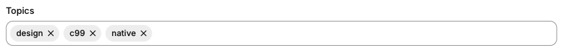

# Tag input

Use a tag input for an ordered list of user-entered labels. Available in **GUI**.



## Example

```pascal
unit Docs.Ui.Inputs.TagInput;

uses Fpas.Ui.Elements as E;
uses Fpas.Ui.Widgets.Inputs.TagInputs as W;

// Builds the tag input example.
// ## Parameters
// - `Topics`: Current value from the application model.
// ## Returns
// The widget for the application view.
public function View(Topics: array of string): E.Element<array of string>;
begin
  return W.TagInput<array of string>('input-topics', Topics,
    function(Value: array of string): array of string => Value,
    new W.Options(Label := 'Topics', Placeholder := 'Add a topic', MaxUtf8Bytes := 255));
end function;

end unit;
```

## Options and defaults

| Option | Default or requirement |
| --- | --- |
| `Tags` | Nonempty single-line strings without commas or surrounding ASCII spaces. |
| `Label / Placeholder` | Empty. |
| `MaxTags` | 64. Accepts 1 through 64. |
| `MaxUtf8Bytes` | 2047, including comma-space separators. Accepts 1 through 2047. |
| `Enabled` | true. |

## Interaction

Enter or comma commits the draft. Backspace in an empty draft removes the last tag. Each existing tag has a remove button. Update the model with the proposed array. Use `RemoveId(Id, Index)` to identify a remove button in GUI snapshots.

## See also

- [Widget API and types](../../../../src/Fpas.Ui/Widgets/Inputs/TagInputs.fpas)
- [Gallery example](../../../../examples/ui/gui/gallery/Pages/Inputs/Widgets/CredentialFields.fpas)
- [Inputs](README.md)

## Source files

- `src/Fpas.Ui.Gui/Internal/Widgets/Inputs/`
  - [TagInput.fpas](../../../../src/Fpas.Ui.Gui/Internal/Widgets/Inputs/TagInput.fpas)
- `src/Fpas.Ui.Gui.Cui/Interop/Inputs/`
  - [NativeMethods.TagInput.cs](../../../../src/Fpas.Ui.Gui.Cui/Interop/Inputs/NativeMethods.TagInput.cs)
- `src/Fpas.Ui.Gui.Cui/Widgets/Inputs/`
  - [CuiWindow.TagInput.Types.cs](../../../../src/Fpas.Ui.Gui.Cui/Widgets/Inputs/CuiWindow.TagInput.Types.cs)
  - [CuiWindow.TagInput.cs](../../../../src/Fpas.Ui.Gui.Cui/Widgets/Inputs/CuiWindow.TagInput.cs)
- `src/Fpas.Ui.Gui.Cui/native/widgets/inputs/`
  - [tag_input.c](../../../../src/Fpas.Ui.Gui.Cui/native/widgets/inputs/tag_input.c)
  - [tag_input.h](../../../../src/Fpas.Ui.Gui.Cui/native/widgets/inputs/tag_input.h)
- `tests/Fpas.Ui.Gui.Cui.Tests/Inputs/`
  - [CuiTagInputTests.cs](../../../../tests/Fpas.Ui.Gui.Cui.Tests/Inputs/CuiTagInputTests.cs)
