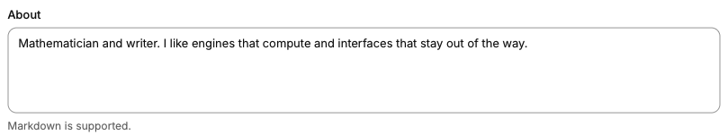

# Text area

Use a text area for wrapping multiline text, such as a profile description. Available in **GUI** and [TUI](../../tui/inputs/text-area.md).



## Example

```pascal
unit Docs.Ui.Inputs.TextArea;

uses Fpas.Ui.Elements as E;
uses Fpas.Ui.Widgets.Inputs.TextAreas as W;

// Builds the text area example.
// ## Parameters
// - `About`: Current value with LF line endings and up to 511 UTF-8 bytes.
// ## Returns
// The widget for the application view.
public function View(About: string): E.Element of string;
begin
  return W.TextArea of string('input-about', About, function(Value: string): string => Value,
    new W.Options(Label := 'About', Hint := 'Write a short profile description.', MaxUtf8Bytes := 511));
end function;

end unit;
```

## Options and defaults

| Option | Default or requirement |
| --- | --- |
| `Value` | Use LF line endings and keep the value within `MaxUtf8Bytes`. |
| `Height` | 96 logical units. Zero uses CUI's default. A negative value fills the available height. |
| `Label / Placeholder / Icon / Hint / Error` | Empty. Error replaces Hint. |
| `Prefix / Suffix` | Empty. Affixes stay outside the editable text. |
| `Clearable / ReadOnly / Enabled` | false / false / true. |
| `ControlSize / MaxUtf8Bytes` | Medium / 4095. |
| `Width / Autofocus` | Null / false. See the [GUI text field options](text-field.md#options-and-defaults). |

## Interaction

Enter inserts LF. Ctrl+Enter invokes the optional submission callback on
Windows and Linux. Up and Down move between visual lines. The wheel scrolls
the field until it reaches an edge, then scrolls the enclosing viewport.
The area edits plain text. Use a single-line [text field](text-field.md) for
masked input. [CUI-021](../../../future/cui-upstream-bugs.md#cui-021)

Use the [Markdown widget](../code/markdown.md) to show a formatted preview.

## See also

- [CUI widget inventory](../../../cui-widget-inventory.md#cui_textarea)
- [Widget API and types](../../../../src/Fpas.Ui/Widgets/Inputs/TextAreas.fpas)
- [Gallery example](../../../../examples/ui/gui/gallery/Pages/Inputs/Widgets/TextArea.fpas)
- [Inputs](README.md)

## Source files

- [Shared About example](../../../../examples/ui/gui/gallery/Shared/AboutField.fpas)

- `src/Fpas.Ui.Gui/Internal/Widgets/Inputs/`
  - [TextArea.fpas](../../../../src/Fpas.Ui.Gui/Internal/Widgets/Inputs/TextArea.fpas)
- `src/Fpas.Ui.Gui.Cui/Interop/Inputs/`
  - [NativeMethods.TextArea.cs](../../../../src/Fpas.Ui.Gui.Cui/Interop/Inputs/NativeMethods.TextArea.cs)
- `src/Fpas.Ui.Gui.Cui/Widgets/Inputs/`
  - [CuiWindow.TextArea.cs](../../../../src/Fpas.Ui.Gui.Cui/Widgets/Inputs/CuiWindow.TextArea.cs)
- `src/Fpas.Ui.Gui.Cui/native/widgets/inputs/`
  - [text_area.c](../../../../src/Fpas.Ui.Gui.Cui/native/widgets/inputs/text_area.c)
  - [text_area.h](../../../../src/Fpas.Ui.Gui.Cui/native/widgets/inputs/text_area.h)
- `tests/Fixtures/gui-host/`
  - [TextAreaContract.fpas](../../../../tests/Fixtures/gui-host/TextAreaContract.fpas)
