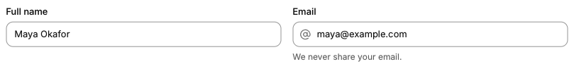
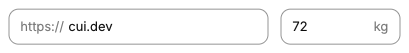

# Text field

Use a text field for a single line of editable text. The gallery shows a name field and an email field with an icon and hint. Available in **GUI and TUI**.



## Example

```pascal
unit Docs.Ui.Inputs.TextField;

uses Fpas.Ui.Elements as E;
uses Fpas.Ui.Widgets.Inputs.TextFields as W;

// Builds the text field example.
// ## Parameters
// - `Name`: Current value from the application model.
// ## Returns
// The widget for the application view.
public function View(Name: string): E.Element of string;
begin
  return W.TextField of string('input-name', Name, function(Value: string): string => Value,
    new W.Options(Label := 'Full name', Placeholder := 'Maya Okafor', MaxUtf8Bytes := 63));
end function;

// Edits the address shown after the HTTPS prefix.
// ## Parameters
// - `Host`: The address without a scheme, up to 95 UTF-8 bytes.
// ## Returns
// A field that sends the edited address without the prefix.
public function Address(Host: string): E.Element of string;
begin
  return W.TextField of string('input-url', Host, function(Value: string): string => Value,
    new W.Options(Prefix := 'https://', MaxUtf8Bytes := 95));
end function;

end unit;
```

## Options and defaults

| Option | Default or requirement |
| --- | --- |
| `Label / Placeholder / Icon` | Empty. Use a label to name the field and a placeholder to suggest a value. |
| `Hint / Error` | Empty. An error replaces the hint. |
| `Prefix / Suffix` | Empty. Affixes stay outside the editable value. |
| `Password / Clearable / ReadOnly / Enabled` | false / false / false / true. |
| `ControlSize / MaxUtf8Bytes` | Medium / 255. The password mode supports a limit of up to 341 bytes. |

## Interaction

In the GUI, use the native caret, selection, clipboard and undo keys while the field has
focus. Enter sends the optional submission message after any edit from that
frame. Replacing the value from the model moves the caret to the end and
clears undo history. A read-only field still allows selection. Password mode
masks the value and supplies a reveal button. GUI snapshots omit the password
value.

For terminal editing and keyboard behavior, see the [TUI text field](../../tui/inputs/text-field.md).

## Prefix and suffix

In Smart inputs, the URL shows an HTTPS prefix and the weight shows a
kilogram suffix. The model stores just the editable address and number.
Build the full URL from the address in the update when you need it.



## See also

- [Widget API and types](../../../../src/Fpas.Ui/Widgets/Inputs/TextFields.fpas)
- [Gallery example](../../../../examples/ui/gui/gallery/Pages/Inputs/Widgets/TextField.fpas)
- [Smart inputs gallery example](../../../../examples/ui/gui/gallery/Pages/SmartInputs/View.fpas)
- [Inputs](README.md)

## Source files

- [Shared gallery example](../../../../examples/ui/gui/gallery/Shared/Profile.fpas)

- `src/Fpas.Ui.Gui/Internal/Widgets/Inputs/`
  - [TextField.fpas](../../../../src/Fpas.Ui.Gui/Internal/Widgets/Inputs/TextField.fpas)
- `src/Fpas.Ui.Gui.Cui/Interop/Inputs/`
  - [NativeMethods.TextField.cs](../../../../src/Fpas.Ui.Gui.Cui/Interop/Inputs/NativeMethods.TextField.cs)
- `src/Fpas.Ui.Gui.Cui/Widgets/Inputs/`
  - [CuiWindow.TextField.Types.cs](../../../../src/Fpas.Ui.Gui.Cui/Widgets/Inputs/CuiWindow.TextField.Types.cs)
  - [CuiWindow.TextField.cs](../../../../src/Fpas.Ui.Gui.Cui/Widgets/Inputs/CuiWindow.TextField.cs)
- `src/Fpas.Ui.Gui.Cui/native/widgets/inputs/`
  - [text_field.c](../../../../src/Fpas.Ui.Gui.Cui/native/widgets/inputs/text_field.c)
  - [text_field.h](../../../../src/Fpas.Ui.Gui.Cui/native/widgets/inputs/text_field.h)
- `tests/Fixtures/gui-host/`
  - [TextFieldContract.fpas](../../../../tests/Fixtures/gui-host/TextFieldContract.fpas)
