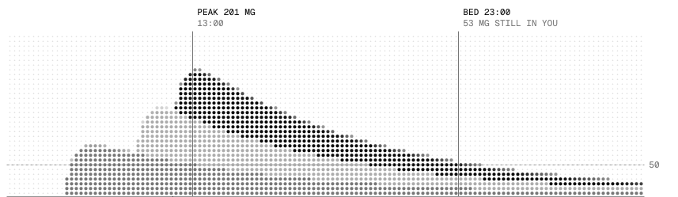

# Dot-matrix chart

Use a dot-matrix chart for equally spaced samples in stacked bands.
The gallery plots each cup's estimated caffeine over time and marks the
threshold, peak and bedtime. Available in **GUI**.



## Example

```pascal
unit Docs.Ui.Instruments.DotChart;

uses Fpas.Ui.Elements as E;
uses Fpas.Ui.Widgets.Charts.Charts as C;
uses Fpas.Ui.Widgets.Charts.DotCharts as W;

// Messages from the chart.
public type Msg = variant
  // Request a new event at the activated X coordinate.
  AddCup(Hit: W.Hit);
end variant;

// Displays five equally spaced samples for each of two cups.
// ## Returns
// The chart for the application view.
public function View(): E.Element of Msg;
begin
  const Bands: array of W.Series := [
    new W.Series([0.0F, 80.0F, 62.0F, 42.0F, 30.0F]),
    new W.Series([0.0F, 0.0F, 30.0F, 32.0F, 24.0F], Accent := true)
  ];
  return W.DotChart of Msg('caffeine', Bands, 5, Msg.AddCup,
    new W.Options(XMinimum := 6.0, XMaximum := 30.0, Units := W.AxisUnits.Hours,
      Range := new C.ValueRange(0.0F, 120.0F), Unit := 'MG',
      Annotations := [new C.Annotation(C.AnnotationKind.Y, Y := 50.0, Label := '50')]));
end function;

end unit;
```

## Options and defaults

| Option | Default or requirement |
| --- | --- |
| `Bands / Count` | Supply up to 16 bands with `Count` equally spaced samples in each. Pass `Count` with no bands to retain the X coordinates. |
| `Series.Values / Accent / Name` | Supply the samples. Accent defaults to false. Name defaults to empty. |
| `XMinimum / XMaximum` | Both 0. Equal bounds select 0 through `max(1, Count - 1)`. Otherwise, supply an increasing interval. |
| `Units / XFormat / XStep` | Number / null / 0. The native number format is `%g`. `Hours` shows 12.25 as 12:15 and wraps at midnight. Zero selects automatic label spacing. |
| `Range / Format / Unit` | null / null / empty. The automatic range begins at zero and ends 8% above the largest stack, or at one for an empty stack. The native value format is `%.0f`. |
| `XLabel / ValueLabel` | Both null. Optional callbacks replace the X labels and the readout's X coordinate or value. |
| `Width / Height / Pitch` | Fill / 0 / 0. The native height is 200 logical units. The default pitch is 6 logical units. CUI limits positive pitch values to 3 through 40. |
| `Grid / Axis / Readout / Enabled` | All true. They control dim dots, X-axis labels, the value label next to the cursor, and input. |
| [`Annotations`](../charts/README.md#annotations) | Empty. Reference lines and points use axis units and the shared annotation colors. |
| `Observed / OnReadout` | Both null. Set the last reported sample and a message mapper to receive changes to the readout. |

The chart stacks bands in array order and interpolates between samples.
Negative values, infinities, NaN and values at or above `1e30` count as zero.
CUI places accented bands in the theme accent color. FPAS passes `Name` to CUI.
The pinned CUI revision omits series names from the readout. [CUI-151](../../../future/cui-upstream-bugs.md#cui-151)

A positive `XStep` sets the distance in X units. The step must advance across the axis range.

Label callbacks run during painting. Capture callback state in the delegate.
Use `XLabel` for the X-axis labels and the readout's X coordinate.
`Units` still controls automatic label spacing. `Unit` follows the text from
`ValueLabel`. FPAS limits each callback's text to 63 UTF-8 bytes and preserves
whole characters.

At the same width, a chart and an event track with the same bounds align their
X coordinates. Set `Axis := false` to use the track's labels. Both axes run
from left to right in right-to-left views.

## Interaction

Click the plot to send `OnActivate` with the exact pointer X coordinate, the
nearest sample index, and the stacked value at that sample. The gallery uses
the coordinate to add a cup and updates the bands in its model.

With the chart focused, press Left or Right to move one sample. Hold Shift to
move ten samples. Home and End jump to the first and last sample. Escape hides
the keyboard cursor. Enter or Space sends `OnActivate` at the cursor. If there
is no cursor or pointer sample, keyboard activation selects the middle sample.

Set `Observed := new Hit(0.0, -1, 0.0F)` to start observing the readout. Store
each `OnReadout` result in the model and pass it back as `Observed`. The result
contains the sample's X coordinate, index, and stacked value. With no sample,
the index is minus one and both values are zero. `Readout := false` hides the
native readout label. The chart still reports sample changes and activation.

## See also

- [CUI widget inventory](../../../cui-widget-inventory.md#cui_dot_chart)
- [Widget API and types](../../../../src/Fpas.Ui/Widgets/Charts/DotCharts.fpas)
- [Gallery example](../../../../examples/ui/gui/gallery/Pages/Instruments/View.fpas)
- [Event track](event-track.md)
- [Instruments](README.md)

## Source files

- `src/Fpas.Ui.Gui/Internal/Widgets/Charts/`
  - [DotChart.fpas](../../../../src/Fpas.Ui.Gui/Internal/Widgets/Charts/DotChart.fpas)
- `src/Fpas.Ui.Gui.Cui/Interop/Charts/`
  - [NativeMethods.DotChart.Types.cs](../../../../src/Fpas.Ui.Gui.Cui/Interop/Charts/NativeMethods.DotChart.Types.cs)
  - [NativeMethods.DotChart.cs](../../../../src/Fpas.Ui.Gui.Cui/Interop/Charts/NativeMethods.DotChart.cs)
- `src/Fpas.Ui.Gui.Cui/Widgets/Charts/`
  - [CuiWindow.DotChart.Types.cs](../../../../src/Fpas.Ui.Gui.Cui/Widgets/Charts/CuiWindow.DotChart.Types.cs)
  - [CuiWindow.DotChart.cs](../../../../src/Fpas.Ui.Gui.Cui/Widgets/Charts/CuiWindow.DotChart.cs)
- `src/Fpas.Ui.Gui.Cui/native/widgets/charts/`
  - [dot_chart.c](../../../../src/Fpas.Ui.Gui.Cui/native/widgets/charts/dot_chart.c)
  - [dot_chart.h](../../../../src/Fpas.Ui.Gui.Cui/native/widgets/charts/dot_chart.h)
